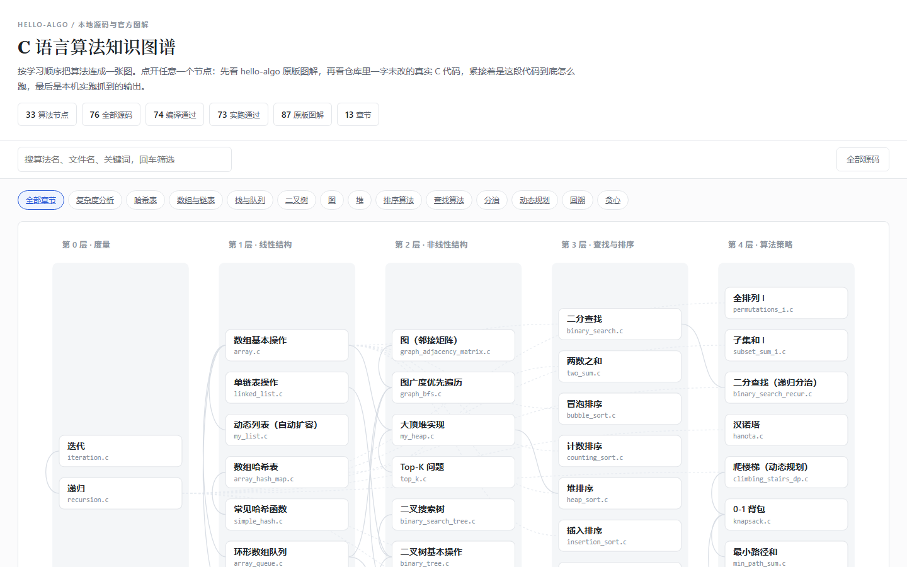
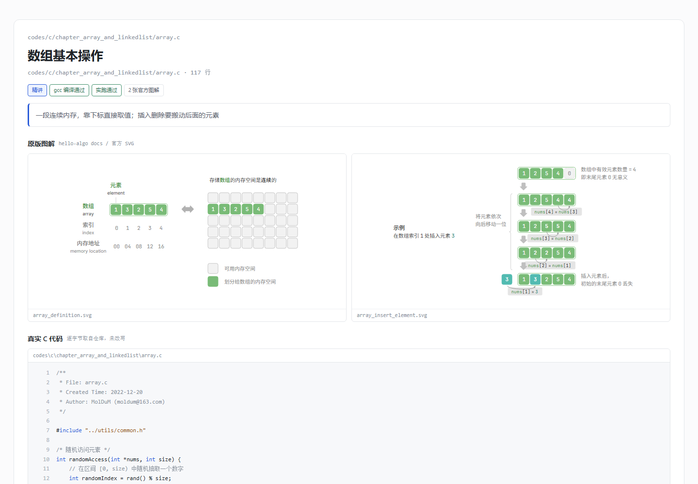

# C 语言算法知识图谱

把 hello-algo 中的 76 个核心算法整理成一张可检索、可下钻、可验证的知识图谱，运行一条命令就能在浏览器里看清「一个算法在整门课里处在哪一层、依赖谁、源码长什么样」。

> 覆盖：数组 / 链表 / 栈 / 队列 / 哈希表 / 树 / 堆 / 图 / 查找 / 排序 / 分治 / 贪心 / 回溯 / 动态规划。
> 算法说明与 C 源码取自开源教材 hello-algo，属第三方素材，署名与许可见第八、九节。

> 《计算机科学导论》课程小组项目 · **13 班 3 组** · 2026 秋
>
> 规模：**5 层 / 13 章 / 76 个算法 / 7174 行 C 源码 / 87 张原理图**
>
> 仓库地址：**https://github.com/NULLFALSE-tech/Algorithm-graph**

## 一、项目简介

一个用 **Python 标准库**实现的本地 Web 程序：启动后在浏览器打开，可以看到 76 个算法按「度量 → 线性结构 → 非线性结构 → 查找排序 → 算法策略」五层铺开成一张有向图，点任意节点展开该算法的原理图、C 源码（逐行着色 + 行号）和依赖关系。

**给谁用**：刚学完 C、正要进数据结构的同学。他们不缺资料，缺的是「这个算法在整张知识网里站在哪、先学什么、代码里哪几行是核心」。

**课程定位**：围绕**复杂度度量（第 0 层）**与**查找排序（第 3 层）**展开，属于课程要求中「计算机基础知识可视化」的范围。对应的导论课知识点：

| 图谱内容 | 对应的导论知识点 |
|---|---|
| 第 0 层「度量」 | 算法复杂度、时间复杂度与空间复杂度的度量方法 |
| 第 1–2 层「线性/非线性结构」 | 数据的逻辑结构与物理存储（顺序存储 vs 链式存储） |
| 第 3 层「查找与排序」 | 典型算法的时间复杂度对比（O(n log n) 与 O(n²)） |
| 依赖边 | 有向图与拓扑序：先修关系必须无环才能成立 |
| 源码逐行展示 | 从高级语言到机器执行的中间表示（词法单元与语法结构） |

### 主要功能

1. **图谱浏览**：打开首页即可看到 5 层、33 个精讲节点与 32 条依赖连线，可横向滚动查看学习顺序。
2. **全量列表**：进入「全部源码」页，按 13 章分组浏览全部 76 条算法，每章附一句定位说明。
3. **搜索定位**：在检索框输入关键词回车，按算法中文名 / 源文件名 / 一句话简介 / 章节名匹配，页面提示「命中 N 份源码（图谱只显示精讲节点）」。
4. **章节筛选**：点章节标签只保留该章算法并高亮标签，点「全部章节」可复位。
5. **查看源码**：点算法卡进入详情页，查看带行号与语法着色的 C 源码、原理图与「这段代码怎么跑」讲解，编译 / 运行状态如实标注。
6. **顺序浏览**：详情页底部提供「← 上一个 / 下一个 →」，按精讲顺序切换，不提供依赖跳转。

## 二、快速开始

### 2.1 环境要求

| 项目 | 要求 | 说明 |
|---|---|---|
| 操作系统 | **Windows 10 / Windows 11**（macOS、Linux 同样可跑） | 无任何系统级依赖 |
| Python | **3.8 及以上** | 实测 3.13.14；**纯标准库，不装第三方包** |
| 浏览器 | Chrome / Edge / Firefox 任一 | 用于查看页面 |
| Git | 2.30 及以上 | 仅拉代码时需要 |

> 为什么是 3.8+：`dict[str, ...]` 这类泛型注解在 3.9 才进标准库，项目里统一加了 `from __future__ import annotations`，所以 3.8 也能跑；代码没有用到 `removeprefix`、`math.lcm` 等 3.9+ 才有的函数。

### 2.2 安装步骤

**第 1 步：确认 Python 已安装**

打开 PowerShell（Win + X → 终端），输入：

```powershell
python -V
```

应输出 `Python 3.8.x` 或更高。若提示「不是内部或外部命令」，到 [python.org](https://www.python.org/downloads/) 下载安装，**安装时务必勾选 `Add Python to PATH`**。

**第 2 步：拿到代码**

```powershell
git clone git@github.com:NULLFALSE-tech/Algorithm-graph.git
cd Algorithm-graph
```

或直接在 GitHub 页面点 `Code → Download ZIP` 解压。

**第 3 步：跑起来**

```powershell
python app.py
```

看到下面这段就成功了，浏览器会自动打开：

```
算法知识图谱 已启动
  算法 76 条 / 精讲 33 条 / 章节 13 个 / 图片 87 张
  地址 http://127.0.0.1:8000/
  停止：Ctrl+C
```

停止服务按 `Ctrl + C`。

### 2.3 界面预览

**首页：5 层图谱**（33 个精讲节点按难度从左到右铺开，连线是「先学谁」的依赖）



**详情页：源码即讲义**（原版原理图 + 逐行着色的 C 源码 + 这段代码怎么跑）



> 两张截图均为实际运行截取，未做美化。截图命令：`msedge --headless --window-size=1440,900 --screenshot=out.png http://127.0.0.1:8000/`

### 2.4 其他命令

| 命令 | 作用 |
|---|---|
| `python app.py` | 启动服务（默认 8000 端口，自动开浏览器） |
| `python app.py --port 8001` | 8000 被占用时换端口 |
| `python app.py --no-browser` | 启动但不自动开浏览器 |
| `python app.py --export _site` | 导出成纯静态站（不再需要 Python 也能看） |
| `python tools/verify.py` | 数据自洽性检查，应输出 `PASS 12 / FAIL 0` |
| `python tests/test_data.py` | 单元测试，应输出 `OK`（10 个测试） |
| `python tools/whoami.py P4` | 查 P4 负责哪几条算法 |

### 2.5 常见问题

| 现象 | 原因与解决 |
|---|---|
| `Address already in use` / `端口被占用` | 换端口：`python app.py --port 8001` |
| 双击 `app.py` 窗口一闪就没了 | 不要双击，在 PowerShell 里 `cd` 到项目目录再 `python app.py` |
| 终端里中文显示成乱码 | PowerShell 执行 `chcp 65001` 切到 UTF-8 后重跑 |
| 页面能打开但图片是空白 | 确认 `data/imgs/` 目录存在（clone 不完整时会出现） |
| `python` 命令不存在 | 试 `py -3 app.py`；或重装 Python 并勾选 Add to PATH |

## 三、项目结构

```
Algorithm-graph/
├── app.py                  # 入口薄壳，等价于 python -m eg.app
├── eg/                     # 程序本体（Python 源代码，137 KB）
│   ├── store.py            #   数据层：读 data/ 下 JSON 与 .c，不认识 HTML
│   ├── graph.py            #   布局层：把「层+章+依赖边」算成屏幕坐标
│   ├── codeview.py         #   着色层：C 源码逐行高亮，单遍扫描不套娃
│   ├── render.py           #   渲染层：用 Python 拼出整站 HTML
│   └── app.py              #   服务层：标准库 http.server 路由
├── data/                   # 可 diff 的数据源（协作的核心）
│   ├── algos.json          #   76 条算法元数据，一条一行
│   ├── codes/              #   76 个 .c 源文件，按 13 章分目录
│   ├── chapters.json       #   章节层级
│   ├── deps.json           #   算法间依赖边
│   ├── layers.json         #   五层定义
│   ├── imgs.index.json     #   图片索引（含 sha1）
│   ├── meta.json           #   全局统计
│   └── imgs/               #   87 张官方原理图（唯一图片源，5.9 MB）
├── web/style.css           # 样式表，不塞进 Python 里
├── tools/                  # 辅助脚本（extract / verify / whoami）
├── tests/test_data.py      # 10 个单元测试
├── docs/                   # 需求文档、AI 使用记录、踩坑记录
└── .github/workflows/      # CI：每次 push 自动跑 verify + tests
```

## 四、技术方案

**核心改动：从「8.37 MB 静态单文件」变成「Python 现场渲染」**

| | 旧版 | 现在 |
|---|---|---|
| 首页体积 | `index.html` **8.37 MB** | **16.4 KB**（缩小 510 倍） |
| 图片 | 87 张 base64 内嵌在 HTML 里 | 独立文件外链，浏览器缓存 |
| 数据流 | 数据塞进 `<script id="DATA">`，浏览器 JS 拼 DOM | Python 在服务端拼好 HTML，前端只剩几十行做悬停高亮 |
| 增删一个算法 | 改 8 MB 文件，diff 无法阅读 | 改 `data/algos.json` 一行 |
| 环境 | 双击即可 | `python app.py`（无第三方依赖） |

**为什么用标准库 `http.server` 而不是 Flask**：课程演示要在老师的机器上跑，Flask 是第三方包，装不上或校园网下载慢都会让「一条命令跑起来」直接失败。标准库零依赖，`python app.py` 在全新机器上也能一次成功。

**为什么服务端渲染**：教材知识点本身是「层级 + 依赖」的结构，Python 里算完坐标直接输出 SVG，比浏览器端算更直观，也让 `tests/` 能用断言锁住「生成的 SVG 与设计稿像素级一致」。

## 五、自检

改完数据一定要跑这两条，CI 也会跑同样的命令：

```powershell
python tools/verify.py        # 期望 PASS 12 / FAIL 0
python tests/test_data.py     # 期望 OK（10 tests）
```

`verify.py` 检查 12 项：字段完整性、id 唯一、章节归属、层级合法、图片引用、依赖图无环、源文件齐全、行数一致性、编译运行状态、备注可用、渲染完整、接口可用。**任何一项不过都不许合并。**

## 六、分支与协作记录

`main` 分支始终可运行、可演示。每次改动走「开分支 → 提交 → 合并回 `main`（`--no-ff`，保留分支拓扑）」，
**不允许直接往 `main` 提交**（除首次初始化）。每次合并前必须 `python tools/verify.py` 全绿 —— CI 也拦这一道。

> 下表 10 条是**第一阶段**（11/14–11/16）的分支，已于 2026-11-19 全部合并进 `main` 后删除。
> 名称保留下来是为了对上 `git log --graph` 里的 10 个 `--no-ff` 合并节点与对应 PR —— 记录不删，分支可删。

| 分支 | 负责人 | 内容 | 合并方式 |
|---|---|---|---|
| `main` | P1 邓宇轩 | 基线、仓库初始化、最终整合 | 保护分支 |
| `chore/repo-spec` | P1 邓宇轩 | `.gitignore`、PR 模板、CI 工作流、任务书（第二阶段已移除；原并入的组员手册与五份职责分工已于 2026-11-17 归档，现行口径见 §7.1 任务卡） | `--no-ff` 合并 |
| `feat/data-extract` | P1 邓宇轩 | 从单文件 HTML 抽 76 条元数据、剥离 87 张 SVG、搬运 76 个 `.c` | `--no-ff` 合并 |
| `feat/core-render` | P1 邓宇轩 | `eg/` 五个模块 + `app.py` + 样式表 | `--no-ff` 合并 |
| `docs/req-01` | P2 王瑞 | 需求文档第一章「背景与目标」 | `--no-ff` 合并 |
| `docs/req-02` | P3 郭子琪 | 需求文档第二章「功能与数据」 | `--no-ff` 合并（**含冲突解决**） |
| `docs/req-03` | P4 张超明 | 需求文档第三章「技术方案与验收」+ 踩坑记录 | `--no-ff` 合并 |
| `feat/search` | P6 焦名远 | 列表页计数提示、搜索框快捷键与无结果引导 | `--no-ff` 合并 |
| `docs/ai-log` | P5 吴家溢 | `AI_Prompts_Log.md` 骨架与六人记录 | `--no-ff` 合并 |
| `feat/verify-tests` | P1 邓宇轩 | `verify.py` 12 项、10 个单元测试、分工查询脚本 | `--no-ff` 合并 |
| `docs/readme` | P1 邓宇轩 | README 定稿：截图、贡献者、协作记录 | `--no-ff` 合并 |

**第二阶段的 5 条分支**：每人只改一个文件、一次交付，合并后即删，不与上表混列。
P5 因首版演示稿与实现不符返工过一轮——同名分支重建、二次提交 `22acc18`、另开 PR #5，故该行登记了两个 PR 号。

| 分支 | 负责人 | 内容 | 状态 |
|---|---|---|---|
| `feature/req-knowledge` | P2 王瑞 | 需求文档重编号 + 新增「二、知识原理」 | PR #1 已合并（`311109d`），已删除 |
| `feature/rep-visual` | P3 郭子琪 | 需求文档新增「四、可视化设计」（分支名把 `req` 误拼成 `rep`，内容无误） | PR #2 已合并（`f9dcd94`），已删除 |
| `feat/readme-mainfunc` | P4 张超明 | README 补「主要功能」6 条 + 开头口径修正 | PR #3 已合并（`3b0514e`，合入 `850a3af`），2026-11-22 删除 |
| `feature/demo-script` | P5 吴家溢 | 新建 `docs/演示脚本.md`，后按实现订正 12 处 | PR #4 已合并（`8493606`，合入 `786a074`）；PR #5 已合并（`22acc18`，合入 `82e5c87`），已删除 |
| `feature/p6-conflict` | P6 焦名远 | §7.1 贡献说明 + 一次真实冲突处理 | 协作者权限已开通（`JMY-0828`），分支待建 |

> P5 的演示稿合并后，P1 逐条对着 `render.py` / `codeview.py` / `app.py` 核对，修掉 **10 处**与实现不符的描述
> （提交 `eb53f37`）。其中三处是页面根本没有的功能：首页的「滚轮缩放、拖拽平移、悬停显示入度出度」（实际只有悬停高亮相连依赖边）、
> 详情页的「填样例数据点运行」（实际是构建时抓好的静态 stdout）、`/all` 的「按章节折叠、一键展开」（不存在）。
> 教训：**演示稿是第二份「需求描述」，它同样会漂**——写稿的人看不见页面时，只能靠想象补动作，而这些动作在录屏里会当场穿帮。

### 6.1 那次真实的合并冲突

`docs/req-01` 与 `docs/req-02` 是从同一个基线分出去的并行分支，两人都要在
`docs/Project_Requirements_and_Design.md` 的**同一张目录表里加自己那一行**，且两行相邻：

```
<<<<<<< HEAD
| 一、背景与目标 | P2 王瑞 | 已完成 |
=======
| 二、功能与数据 | P3 郭子琪 | 已完成 |
>>>>>>> docs/req-02
```

**解决方式**：两人改的其实不是同一个单元格，是「同一张表相邻两行」，所以**两行都保留**，
只是顺序按章节号排。合并后在 PR 里留了说明，过程记录写进 `docs/踩坑记录.md` 第 6 条。

> 顺带记一个教训：正因为 `algos.json` 采用「一条算法一行」的写法，**同一行改两个字段就必然冲突**。
> 好处是冲突范围永远可控（不会出现整文件冲突），坏处是六人并行时要约定「谁改哪个字段」。

### 6.2 第二阶段：任务卡与分工表的口径冲突

第二阶段开工时，同一个人的任务在**两份文档里被写成了两件事**：

| 文档 | 对 P4 任务的描述 |
|---|---|
| `docs/组员任务卡_2026-11-21/P4_张超明_任务卡.md` | 更新 README §7.1 的引导语与整张分工表，提交信息固定为 `docs(readme): 更新 §7.1 第二阶段分工为新口径` |
| `README.md` §7.1 分工表（本文件） | README 补「主要功能」6 条 + 全仓「数据结构」口径巡检 |

P4 按 §7.1 表格执行，交了 PR #3（单次提交 `850a3af`，+10 −1，只动 `README.md` 开头一句和新增的「主要功能」一节）。
两份描述**都查得到出处**，不是谁疏忽做错，而是同一条信息写了两遍，改一处就漂。

**处理**：以 README §7.1 为准（它是仓库内的现行口径，任务卡只是发放时的一次性快照），PR #3 原样合并；
任务卡里「更新 §7.1 引导语与整表」这一条视为过期动作，不再执行。
同批修掉的口径问题（需求文档开头与 3.2 标题、P2/P3/P5 任务卡提示词、P5 卡里的分支数）见提交 `16fea1d`。

**代价与重排**：P6 的任务设计是「与 P4 同一时刻开分支、两人改 §7.1 同一张表撞出冲突」。
P4 既然没动 §7.1，这个前提就不成立。重排为：P6 先按自己的分支提交并提 PR，
由 P1 随后在 `main` 上改 §7.1（把计划表更新为成果表），让 P6 的 PR 真的撞出冲突后再解。
冲突仍是从两个分支的真实改动里长出来的，不是造出来的。

**教训**：任务卡不重复描述「做什么」，只写「怎么交、什么时候交」，具体任务一律指向 README §7.1。
一处定义、多处引用，才不会再漂。

### 6.3 提交信息格式

统一 `type(scope): 一句话说明`，动词开头、不加句号：

| 前缀 | 用于 | 例 |
|---|---|---|
| `feat` | 新功能 | `feat(检索): 列表页加计数提示` |
| `fix` | 修 bug | `fix(app): 端口被占用时自动顺延` |
| `docs` | 文档 | `docs(需求): 写第二章 功能与数据` |
| `chore` | 杂务 | `chore(ci): 加 PR 模板与自动校验` |
| `test` | 测试 | `test: 补 2 个数据一致性用例` |

## 七、团队分工与贡献者

| 代号 | 姓名 | 分工 | 主要交付物 | 所在分支 |
|---|---|---|---|---|
| P1 | **邓宇轩**（组长） | 仓库与流程、数据抽取、程序本体、集成与合并 | `eg/`、`app.py`、`README.md`、`tools/` | `chore/repo-spec`、`feat/data-extract`、`feat/core-render`、`feat/verify-tests`、`docs/readme` |
| P2 | **王瑞** | 需求文档「一、背景与目标」 | `docs/Project_Requirements_and_Design.md` §1 | `docs/req-01` |
| P3 | **郭子琪** | 需求文档「三、主要功能与数据」 | 同上 §3 | `docs/req-02` |
| P4 | **张超明** | 需求文档「五、技术方案与验收」（先遣员） | 同上 §5、`docs/踩坑记录.md` | `docs/req-03` |
| P5 | **吴家溢** | AI 使用记录汇总（6 人 18 次交互） | `docs/AI_Prompts_Log.md` | `docs/ai-log` |
| P6 | **焦名远** | 检索页与列表页 | `eg/render.py` 的 `search` / `list_html` | `feat/search` |

> 章号为 2026-11-16 重编号后的现行编号（原二/三 → 现三/五），第二阶段补齐的章节见 §7.1。
> 「所在分支」列是第一阶段的历史分支名，均已于 2026-11-19 合并后删除，见 §6。

六人的 GitHub 账号对照（2026-11-22 核对，六人全部已接受邀请，权限均为 Write 以上）：

| 代号 | 姓名 | GitHub 账号 | 仓库权限 |
|---|---|---|---|
| P1 | 邓宇轩 | `NULLFALSE-tech` | Owner |
| P2 | 王瑞 | `wangrui-maker` | Write |
| P3 | 郭子琪 | `guoziqi-higher` | Write |
| P4 | 张超明 | `shayubei` | Write |
| P5 | 吴家溢 | `cthvme50` | Write |
| P6 | 焦名远 | `JMY-0828` | Write |

`git shortlog -sne` 显示的是上面这串账号名，不是中文真名 —— 对不上时查这张表。

提交记录可用两条命令核对（作者名与上表一致）：`git shortlog -sne` 看六人各提交了多少次，
`git log --graph --oneline` 看分支拓扑与 10 个 `--no-ff` 合并节点。

分工可按脚本复核，不靠嘴说：

```powershell
python tools/whoami.py        # 六人总览 + 76 条是否不重不漏
python tools/whoami.py P4     # 只看 P4 负责的章与算法
```

### 7.1 第二阶段分工（2026-11-21 起）

第一阶段（11/14–11/16）把项目从零做出来：数据抽取、服务层、三章需求文档、检索页。
第二阶段（11/21 起）按课程要求的六块结构补齐缺口，细则与验收命令见
[`docs/组员任务卡_2026-11-21/`](docs/组员任务卡_2026-11-21/)。

> **关于时间**：课程没有给出提交截止时间——课堂逐句稿（1709 行）与书面要求
> （`导论大作业v1.2.md`，137 行）里都没有任何具体日期。**本作业不存在「某日之前必须交」
> 的红线**，各班组的进度按自身安排自由推进即可。下表不加日期，也不设先后顺序。

| 代号 | 姓名 | 第二阶段任务 | 目标文件 |
|---|---|---|---|
| P1 | 邓宇轩 | 合并全部 PR、录演示视频（组内仅由他录制） | — |
| P2 | 王瑞 | 补「二、知识原理」1200–1500 字 | `docs/Project_Requirements_and_Design.md` |
| P3 | 郭子琪 | 补「四、可视化设计」输入→处理→展示→交互，1000–1300 字 | 同上 |
| P4 | 张超明 | README 补「主要功能」6 条 + 全仓「数据结构」口径巡检 | `README.md` |
| P5 | 吴家溢 | 演示视频分镜与口播稿 + 全组提交规范巡检 | `docs/演示脚本.md` |
| P6 | 焦名远 | 补本人贡献说明：第一阶段交付检索页与列表页（列表计数提示、搜索框快捷键、无结果引导） | `README.md` §7.1 |

`python tools/whoami.py P2` 会把两个阶段的任务一起打印出来，不用记。

## 八、数据来源

算法与源码来自开源项目 [hello-algo](https://github.com/krahets/hello-algo)（MIT 许可）。本仓库做的是**结构化整理与可视化**，不修改原算法实现。

## 九、许可

本项目代码采用 **MIT License**，全文见 [LICENSE](LICENSE)。

原算法讲解、C 源码与原理图版权归 **hello-algo** 项目作者（krahets）所有，遵循其 MIT 许可；
本仓库仅做结构化整理与可视化，用于课程学习，不作商业用途。

