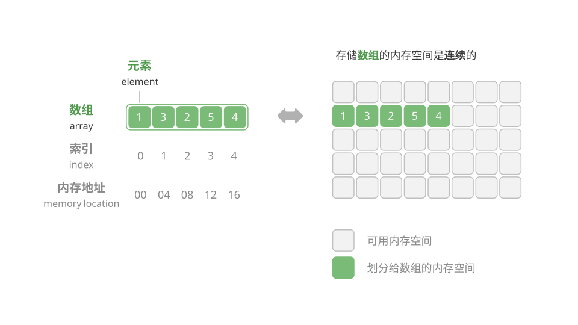

# 计算机科学基础概念可视化探索 · 项目需求与设计

> **课程**：计算机科学导论（2026 级）
> **组别**：13 班 3 组
> **选题**：C 语言算法知识图谱 —— 76 个经典算法的分层浏览与源码精讲
> **版本**：v1.0　**定稿日期**：2026-11-16

本项目把《数据结构》课程里的 76 个核心算法（数组、链表、栈、队列、哈希表、树、堆、图、查找、排序、分治、贪心、回溯、动态规划）的讲解与 C 源码，重组成一张**按难度分层、按依赖连边**的知识图谱，
让刚学完 C、准备进数据结构的同学能「先看全貌，再挑一条路走」。

> 说明：算法讲解、C 源码与原理图取自开源教材 hello-algo（MIT 许可），本项目的工作是**结构化整理与可视化**，不修改原算法实现；来源与许可见 README 第八、九节。

---

## 目录

| 章节 | 负责人 | 状态 |
|---|---|---|
| 全文统筹与合并 | P1 邓宇轩 | 已建骨架 |
| 一、背景与目标 | P2 王瑞 | 已完成 |
| 二、知识原理 | P2 王瑞 | 已完成 |
| 三、主要功能与数据 | P3 郭子琪 | 已完成 |
| 五、技术方案与验收 | P4 张超明 | 已完成 |
| AI 使用记录 | P5 吴家溢 | 见 `docs/AI_Prompts_Log.md` |
| 检索页与列表页 | P6 焦明远 | 见 `eg/render.py` |

---

## 一、背景与目标

### 1.1 项目背景

《计算机科学导论》讲到数据结构这一章时，同学普遍卡在同一个地方：**单个算法看得懂，但不知道它在整张地图的哪个位置**。
课本按章线性排列，学到第 5 章已经忘了第 2 章讲过什么；刷题时遇到「这题该用 DP 还是贪心」，也说不清两者的分界。

课程原始要求里写明选题可以是「其他计算机基础知识（如经典排序/查找算法、进程调度、页面置换等）的可视化」，
本组据此选了比单点演示器更完整的一条路：**把 76 个算法整体搬进一张可交互的图谱**，而不是只做一个补码计算器。

### 1.2 目标用户与痛点

- **主要用户**：刚学完 C 语言、正在准备数据结构的大一同学（本组成员自己就是）。
- **典型场景 1**：老师布置「预习二叉树」，同学打开教材发现前面还压着链表和队列，不知道该不该回头补。
- **典型场景 2**：想读某个算法的源码，但不知道它的前置算法是什么，读三行就卡住。
- **典型场景 3**：复习时想按「由浅入深」的顺序过一遍，但教材的章节顺序不等于难度顺序。

### 1.3 项目目标

1. **一张图看全貌**：把 13 章 76 个算法铺成 **5 层**结构，任意算法点开后 3 次点击内可达其源码与讲解。
2. **依赖可追溯**：用 32 条依赖边标出「学 B 之前要先学 A」，点任一前置节点可跳转。
3. **源码即讲义**：每个算法配「这段代码到底怎么跑」三列表格（阶段 / 代码在做什么 / 变量与内存怎么变），而不是只贴代码。
4. **零依赖可复现**：老师在自己的电脑上 `python app.py` 一条命令跑起来，不装任何第三方包。

### 1.4 与课程要求的关系

本项目的文档、协作、AI 使用三部分，直接对应课程评分表的三个维度：
**文档规范（20%）** 对应本文件与 `README.md`；**协作流程（30%）** 对应 8 条功能分支与一次真实合并冲突；
**Vibe Coding（25%）** 对应 `docs/AI_Prompts_Log.md` 里 6 人 18 次提示词的原始记录。

> 说明：以上「痛点场景」来自本组成员的**自述观察**，未做问卷调研，不冒充数据结论。

## 二、知识原理

### 2.1 五层递进的知识主线

13 章按依赖深度排成 5 层。层号不表示难度高低，只表示前置依赖链的长度：站上第 k 层，意味着比它低的各层都已经掌握。
- **第 0 层**：度量（复杂度分析）解决“两段代码谁更快”，先给出统一的衡量标准。如果没有这一层，后面每次选择存储结构时都只能凭感觉。
- **第 1 层**：线性结构解决“数据怎么存”。数组与链表确定了顺序存储和链式存储两种基本布局，栈与队列是在这两个布局上增加的使用限制，哈希表用数组加冲突处理来换取常数级查找。这一层是后面所有结构的存储基础，线性查找也在这里第一次落实到具体的存储布局上。
- **第 2 层**：非线性结构解决“关系不止一条线”。二叉树把分支写进结构，堆在二叉树的基础上再加一条顺序约束，图允许任意连接。它们仍然要依赖第 1 层的存储方式：堆用数组存放，图的邻接关系靠数组和链表表示。二叉树遍历在这一层把“沿结构走一遍”变成了固定套路。
- **第 3 层**：查找与排序解决“在已有数据上找到并按序组织”。二分查找要求有序且能按下标访问，堆排序要求有现成的堆；这两点都绕不开前两层。
- **第 4 层**：算法策略解决“换一类问题怎么办”。分治、回溯、动态规划、贪心把前面各层的具体做法提炼成可复用的思路，深度优先遍历与广度优先遍历到了这一层可以作为通用框架来调用，例子仍然取自前几层。

### 2.2 依赖边的方向规则

每条边写成「前置 → 后继」，含义只有一句：学会前者，才谈得上理解后者。方向不可逆，13 章之间共 32 条边，全部由三条规则生成，每条边的两端都是不同节点。

1. 同一章内的概念递进。冒泡排序 → 插入排序：先看清相邻交换怎样把有序区一点点扩大，再学插入排序，把元素插入已排好的前缀；后者是前者的更严格形式，也为后面的快速排序、归并排序留好了对照。
2. 跨章的能力依赖。分治 → 动态规划：先会用分治把问题拆成互不重叠的子问题，才会遇到子问题反复出现时是否该把结果存下来的取舍。
3. 数据结构支撑算法。哈希表 → 哈希查找：查找能落到常数级，前提是哈希表已经把键映射成了下标，换一种冲突处理方式，这条边就未必成立。

三条规则之外不补边。教材顺序、名字相近、篇幅相当都不构成依赖，只有不学前者就讲不下去，才连一条边。

### 2.3 精讲节点的筛选依据

76 条算法里有 33 条标为 core，配精讲，其余只给结论与源码。筛选按三条标准依次过：

1. 该章最基础的一种实现。一章常有好几种写法，选最贴近定义的那一种讲透，其余留作对照。
2. 其它算法以它为前置。在依赖图上有出边的节点优先：把一个节点讲清楚，等于一次解锁多个后继。
3. 面试与课程高频。同一层里被反复问到的实现优先入选，保证精讲覆盖的是真正会用到的部分。

三条都满足的直接进，只满足两条的按第二条优先。精讲的关键是把有后继的条目讲透，并非提前讲解简单条目。剩下的是查阅型条目，给出复杂度与源码即可。

## 三、主要功能与数据

### 3.1 功能清单

| 编号 | 功能 | 用户动作 | 系统响应 | 优先级 |
|---|---|---|---|---|
| F1 | 图谱浏览 | 打开首页 | 渲染 5 层 33 个精讲节点与依赖连线，可横向滚动 | P0 |
| F2 | 全量列表 | 点「全部源码」 | 按 13 章分组列出 76 条，每章带一句定位说明 | P0 |
| F3 | 搜索定位 | 输入关键词回车 | 匹配 `name` / `brief` / `id`，顶部提示「共 76 条，当前显示 N 条」 | P0 |
| F4 | 章节筛选 | 点章节标签 | 只保留该章算法，标签高亮 | P1 |
| F5 | 查看源码 | 点算法卡 | 服务端高亮 C 源码，带行号与语法着色 | P0 |
| F6 | 查看依赖 | 打开详情页 | 列出前置算法（可点击跳转）与后继算法 | P1 |
| F7 | 静态导出 | 跑 `python -m eg.app --export` | 输出纯静态站点，图片链接改相对路径 | P2 |

> 页面风格统一、不引外部字体与 CDN，保证断网也能演示。

*图 1：项目内 87 张原理图之一（数组的定义），随仓库一起分发，不依赖外网*

### 3.2 数据结构

`data/algos.json` 是唯一的数据入口，**一条算法一行**，便于 diff 与逐行 review。

| 字段 | 含义 | 谁在用 |
|---|---|---|
| `id` | 唯一英文标识，同时是 URL 片段 | `eg/store.py` 建索引、路由 `/a/<id>` |
| `stem` | 源文件名（不含 `.c`） | `eg/store.py` 拼 `data/codes/<ch>/<stem>.c` |
| `ch` | 所属章节 key | 分组、筛选、章节标题查表 |
| `name` / `brief` | 中文名 / 一句话是什么 | 卡片、搜索结果、详情页标题 |
| `layer` | 0–4，难度层 | `eg/graph.py` 决定横向列 |
| `lines` / `code_lines` | 源码行数（两处口径，校验项第 8 条比对） | 「行数一致性」检查 |
| `note` | 讲解对象：`steps` / `detail` / `analogy` / `cost` / `kind` | 详情页「这段代码怎么跑」 |
| `compile` / `run` | `OK` / `FAIL` / `TIMEOUT` | 详情页状态标签，如实显示 |
| `out` / `err` | 实际运行输出 / 编译报错 | 详情页「跑出来是什么」 |
| `imgs` | 引用的 SVG 路径 | 详情页配图、图片索引校验 |

配套四份索引：`chapters.json`（13 章，含层级与一句定位）、`layers.json`（5 层名称）、
`deps.json`（32 条 `[前置, 后继]` 边）、`imgs.index.json`（87 张图 + sha1 校验值）。

### 3.3 数据规模（真实值）

- 算法 **76** 条，源码合计 **7174** 行，其中标 `core` 的精讲节点 **33** 条
- 章节 **13** 章，分 **5** 层：第 0 层 1 章 6 条 · 第 1 层 3 章 13 条 · 第 2 层 3 章 14 条 · 第 3 层 2 章 13 条 · 第 4 层 4 章 30 条
- 依赖边 **32** 条，配图 **87** 张（合计 5.9 MB）

### 3.4 已知缺口（不隐瞒）

| 类型 | 条数 | 具体 |
|---|---|---|
| 编译未通过 | 2 | `graph_adjacency_list`、`my_heap`——链接阶段 `ld.exe` 报错；离线手编会先卡在 `#include "../utils/common.h"`（原站 utils 目录未随仓库搬运） |
| 运行超时 | 1 | `time_complexity`（本身就要跑指数级循环，属预期） |
| 未运行 | 2 | 即上面两条编译失败的，无产出可比对 |

页面上这三类**如实标注**，不做成「全部正常」的假象；`tools/verify.py` 第 9 条「编译运行状态」只校验枚举合法，不要求全 OK。

## 五、技术方案与验收

### 5.1 技术选型与理由

**结论：Python 标准库 `http.server` + 服务端渲染，零第三方依赖。**

1. **零依赖部署**：课程演示要在老师机器上现场跑。Flask 是第三方包，校园网下载慢或装不上，「一条命令跑起来」就直接失败。
2. **教师可复现**：`python app.py` 只要求 Python 3.8+，Windows / macOS / Linux 一致。
3. **新手能改**：组员只有 C 基础，读 `eg/render.py` 里拼 HTML 的 f-string 比读 React 组件容易得多。

### 5.2 架构分层

| 层 | 文件 | 职责 | 不许做什么 |
|---|---|---|---|
| 服务层 | `eg/app.py`（320 行） | `http.server` 路由、静态导出、端口顺延 | 不拼 HTML |
| 渲染层 | `eg/render.py`（469 行） | 所有页面 HTML 由这里生成 | 不读文件、不算坐标 |
| 着色层 | `eg/codeview.py`（147 行） | C 源码单遍词法扫描上色 | 不认识算法与章节 |
| 布局层 | `eg/graph.py`（132 行） | 把「层 + 章 + 依赖边」算成屏幕坐标 | 不认识 HTML |
| 数据层 | `eg/store.py`（148 行） | 只读 `data/` 下 JSON 与 `.c` | 不认识 HTTP |

依赖方向**单向**：`app → render → codeview / graph → store`。跨层调用会被 `tools/verify.py` 第 12 条「接口可用」与 code review 挡下。

### 5.3 关键决策：为什么把 8.37 MB 拆成 16.4 KB

最初版本是**单个 HTML 文件**，87 张图以 base64 内嵌，体积 8.37 MB。由此带来三个死结：

- **diff 不可读**：改一句话，Git 显示 8 MB 变动，review 形同虚设；
- **无法并行**：六个人改同一个文件，必然天天冲突；
- **浏览器扛不住**：首屏要解析 8 MB DOM。

拆分后：图片落成 87 个独立 SVG（浏览器可缓存），数据落成 6 个 JSON（一条一行、可逐行 review），
模板交给 Python，首页 **16.4 KB，缩小 510 倍**。

代价也真实存在：`algos.json` 采用「一条算法一行」，好处是 diff 干净，
坏处是**同一行改两个字段就必然冲突**——本次 P2 与 P3 在目录表相邻行的冲突就是同类问题。

### 5.4 验收标准

**自动化**（`python tools/verify.py` + `python tests/test_data.py`）

- `verify.py` 12 项全绿：字段完整性、id 唯一、章节归属、层级合法、图片引用、依赖图无环、源文件齐全、行数一致性、编译运行状态、备注可用、渲染完整、接口可用
- 10 个单元测试通过；CI（`.github/workflows/check.yml`）每次 push 自动跑

**人工**

- 8 分钟内能完整演示：首页图谱 → 搜索 → 详情 → 源码 → 依赖跳转
- 1024×768 投影分辨率下不横向裁切
- 任意算法 3 次点击内可达

### 5.5 风险与对策

| 风险 | 对策 |
|---|---|
| 数据漂移（JSON 与 `.c` 行数对不上） | 校验第 8 条逐条比对；CI 拦住 |
| 多人改同一 JSON 冲突 | 一条一行 + 按章节分工，冲突范围可控；冲突解决记录入 `docs/踩坑记录.md` |
| 演示机装不上依赖 | 零第三方依赖，只用标准库 |
| 端口被占用 | `--port` 可指定，冲突时自动顺延并打印真实端口 |
| AI 编造统计数据 | 文档里每个数字必须能指向具体文件，写不出就标「待核实」 |

## 六、团队分工

| 代号 | 姓名 | 负责内容 | 交付物 |
|---|---|---|---|
| P1 | 邓宇轩 | 组长：仓库、数据抽取、服务层、集成与合并 | `eg/`、`app.py`、`README.md` |
| P2 | 王瑞 | 需求文档「一、背景与目标」 | 本文件第一章 |
| P3 | 郭子琪 | 需求文档「三、主要功能与数据」 | 本文件第三章 |
| P4 | 张超明 | 需求文档「五、技术方案与验收」（先遣员） | 本文件第五章、`docs/踩坑记录.md` |
| P5 | 吴家溢 | AI 使用记录汇总（6 人） | `docs/AI_Prompts_Log.md` |
| P6 | 焦明远 | 检索页与列表页 | `eg/render.py` |

### 第二阶段分工（2026-11-21 起）

上表是第一阶段（11/14–11/16，项目从零到 v1.0）。第二阶段按课程要求的六块结构补缺口，
任务细则、提示词与验收命令见 [`docs/组员任务卡_2026-11-21/`](组员任务卡_2026-11-21/)。

| 代号 | 姓名 | 第二阶段负责 | 目标文件 |
|---|---|---|---|
| P1 | 邓宇轩 | 合并全部 PR、录制演示视频 | — |
| P2 | 王瑞 | 补「二、知识原理」 | 本文件 |
| P3 | 郭子琪 | 补「四、可视化设计」 | 本文件 |
| P4 | 张超明 | README「主要功能」+ 全仓口径巡检 | `README.md` |
| P5 | 吴家溢 | 演示分镜与口播稿 + 提交规范巡检 | `docs/演示脚本.md` |
| P6 | 焦明远 | 自检脚本补 2 项 | `tools/verify.py` |

---

## 附：修订记录

| 日期 | 版本 | 变更 | 负责人 |
|---|---|---|---|
| 2026-11-14 | v0.1 | 建骨架与目录，确定三章分工 | P1 邓宇轩 |
| 2026-11-15 | v0.5 | 补「一、背景与目标」 | P2 王瑞 |
| 2026-11-15 | v0.6 | 补「二、功能与数据」，与 P2 目录表冲突并人工解决 | P3 郭子琪 |
| 2026-11-16 | v0.9 | 补「三、技术方案与验收」 | P4 张超明 |
| 2026-11-16 | v1.0 | 合并定稿，补分工表与图片 | P1 邓宇轩 |

---
