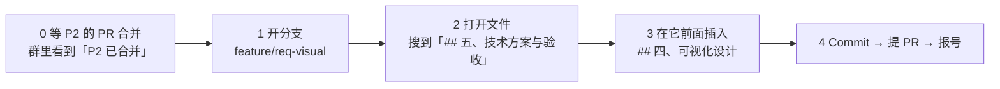

# P3 郭子琪 · 任务卡

| 项 | 内容 |
|---|---|
| 你负责 | 在需求文档新增「四、可视化设计」 |
| 分支 | `feature/req-visual` |
| 改哪个文件 | `docs/Project_Requirements_and_Design.md`（只改这一个） |
| 提交信息（逐字复制） | `docs(req): 新增「四、可视化设计」输入-处理-展示-交互` |
| 耗时 | 25 分钟 |
| 什么时候做 | 11/21 下午（**必须先等 P2 的 PR 合并完**，否则你们改的是同一份文件，会整篇冲突） |
| 提交次数 | 1 次 |

---

## 一、你的流程



**为什么必须等 P2**：P2 要把全篇编号从「一、二、三」重排成「一、二、三、五、六」。如果他还没合并你就动手，你插进去的「四、」会和他改过的编号混在一起，整份文件冲突，谁都不好收拾。

---

## 二、操作步骤

### 步骤 1 · 开分支

```text
打开 https://github.com/NULLFALSE-tech/Algorithm-graph/branches
→ 右上绿色按钮 New branch
→ 输入 feature/req-visual → Create new branch
```

⚠️ 开分支前，先看一眼 `https://github.com/NULLFALSE-tech/Algorithm-graph/commits/main`，最新一条应该是 P2 的「需求文档重编号并新增「二、知识原理」」。如果没有，说明还没合并，等一下。

### 步骤 2 · 打开文件

```text
https://github.com/NULLFALSE-tech/Algorithm-graph/blob/feature/req-visual/docs/Project_Requirements_and_Design.md
→ 右上角铅笔图标
```

### 步骤 3 · 定位插入点

1. 浏览器 `Ctrl+F` 搜 `## 五、技术方案与验收`
2. 把光标点到这一行的**最前面**
3. 按回车空出一行，光标回到空行

### 步骤 4 · 粘贴 AI 产出

把下面第四节提示词产出的内容整段粘到这个空行位置。粘完检查一下：「四、可视化设计」必须在「三、主要功能与数据」之后、「五、技术方案与验收」之前。

### 步骤 5 · 提交

```text
滚到页面底部 → Commit changes
第一行填：docs(req): 新增「四、可视化设计」输入-处理-展示-交互
第二行留空
⚠ 确认勾选 "Commit directly to the feature/req-visual branch"
→ Commit changes

出现 Compare & pull request → 点它 → 标题填同一句 → Create pull request
群里报一句：PR #编号 已提
```

---

## 三、可复制给 AI 的提示词

整段复制，粘到任意 AI 对话框。**这段提示词里的页面行为都是实测过的，AI 会很想给你加功能，加了就是错的。**

```text
你在给一个「数据结构知识图谱」的 Web 项目补写需求文档的一章。服务端是 Python 标准库 http.server，前端是纯 HTML/CSS/JS，无框架无 CDN。

【页面真实行为，必须严格按此写，多一条都不许编】
1. 首页 /：横向 5 列渲染 33 个精讲节点，节点之间按依赖关系画 32 条连线，可横向滚动
2. 首页检索框：输入关键词回车后，命中的节点高亮、未命中的淡化，图上方出现一行「命中 N 份源码」。检索是子串匹配、大小写不敏感，匹配五个字段：算法中文名 / 源文件名 / 一句话简介 / 文件路径 / 章节名；无排序、无截断
3. /all 页：按 13 章分组列出全部 76 条，每章带一句定位说明，点章节标签可筛选并高亮
4. 详情页 /a/<id>：标题、中文名、一句话简介、带行号与语法着色的 C 源码、「这段代码怎么跑」讲解、编译/运行状态标签（OK / FAIL / TIMEOUT 如实显示）、实际输出、配图；底部只有「← 上一个 / 下一个 →」两个按钮

【绝对不许写的功能（写了就是幻觉，已在评审中被抓到过）】
- 依赖跳转 / 点前置算法跳转（详情页没有这个按钮）
- 定位到源码某一行 / 逐行溯源
- 页面上有任何「导出」按钮（导出是命令行 python -m eg.app --export，不是按钮）
- 登录、收藏、分享、导出 PDF、暗色模式

【要写什么】
四小节，每节 150–250 字：
4.1 输入——用户能输入什么（检索框关键词、章节筛选点击、算法卡点击），不用输入什么
4.2 处理——服务端拿到输入后做了什么（建内存索引、子串匹配、按章分组、按层分列），一句话说清没有数据库
4.3 展示——四类视图各自的版面（首页图谱 / 全量列表 / 详情页 / 检索结果态），说清信息层级
4.4 交互——可点击的东西有哪些、点击后的反馈是什么、哪些地方故意不做交互（例如详情页不提供依赖跳转），并说明理由

【硬性禁止】
- 不许贴大段代码，最多出现 3 个短标识符
- 不许出现「用户友好的界面」「良好的体验」这类评价词，只描述行为
- 不许编造上面没给出的页面或按钮

【输出格式】
只输出 Markdown 正文，从下面这一行开始：

## 四、可视化设计

### 4.1 输入
...
```

---

## 四、自己检查（提交前逐条过）

| # | 怎么查 | 通过标准 |
|---|---|---|
| 1 | `Ctrl+F` 搜 `## 四、可视化设计` | 出现 1 次，位置在「三、主要功能与数据」之后 |
| 2 | 搜 `### 4.` | 有 4.1 / 4.2 / 4.3 / 4.4 四条，编号连续 |
| 3 | 搜「依赖跳转」 | **搜不到**（搜到就是 AI 编的，删掉） |
| 4 | 搜「导出」 | 最多出现 1 次，且后面跟的是 `python -m eg.app --export`，不能是「导出按钮」 |
| 5 | 搜「登录」「收藏」「暗色」「分享」 | 全部搜不到 |
| 6 | 搜「用户友好」「良好体验」 | 全部搜不到 |

---

## 五、验收提示词（把这一章贴给 AI）

```text
你是课程作业的验收员。下面是一份需求文档里「四、可视化设计」一章的全文，逐条检查，给 PASS 或 FAIL。

1. 必须恰好有 4.1 输入 / 4.2 处理 / 4.3 展示 / 4.4 交互 四个三级标题，名称与顺序一致，多一个少一个即 FAIL。
2. 出现以下任何一个词即 FAIL：依赖跳转、定位到源码某一行、逐行溯源、登录、收藏、分享、暗色模式、导出按钮。
3. 「导出」只允许以 `python -m eg.app --export` 的命令行形式出现，若写成页面按钮即 FAIL。
4. 出现「用户友好」「良好的体验」「极大地」「赋能」即 FAIL，列出原句。
5. 每小节必须达到 150 字以上，少于 150 字即 FAIL 并给出实际字数。
6. 4.2 必须明确写出「没有数据库」或「数据存在内存里」这类意思的句子，缺失即 FAIL。
7. 4.4 必须说明「哪些地方故意不做交互」并给理由，缺失即 FAIL。

输出格式：一张 3 列表格「条目 | 结果 | 问题位置」，最后一行写「PASS n 条，FAIL m 条，结论：可提交 / 需返工」。
不要复述标准。
```
