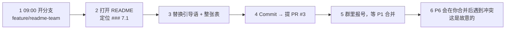

# P4 张超明 · 任务卡

| 项 | 内容 |
|---|---|
| 你负责 | 更新 README 的 §7.1 第二阶段分工（引导语 + 表格） |
| 分支 | `feature/readme-team` |
| 改哪个文件 | `README.md`（只改这一个，只改 §7.1 那一节） |
| 提交信息（逐字复制） | `docs(readme): 更新 §7.1 第二阶段分工为新口径` |
| 耗时 | 15 分钟 |
| 什么时候做 | **11/22 上午 09:00 开分支**（要和 P6 同时开，原因见下） |
| 提交次数 | 1 次 |

---

## 一、你的流程



**为什么必须 09:00 开分支**：P6 的活是「制造一次真实的合并冲突」——他也改 §7.1 这张表里自己那一行。他必须基于**你改之前的旧表**开分支，两人同时开才会撞车。如果你先合并了他才开分支，他拿到的就是新表，永远撞不上，这一步就白费了。

你只管按时间开分支、改完提 PR，冲突由 P1 那边处理，**你不用管 P6 的操作**。

---

## 二、操作步骤

### 步骤 1 · 开分支

```text
打开 https://github.com/NULLFALSE-tech/Algorithm-graph/branches
→ 右上绿色按钮 New branch
→ 输入 feature/readme-team → Create new branch
```

### 步骤 2 · 打开 README

```text
https://github.com/NULLFALSE-tech/Algorithm-graph/blob/feature/readme-team/README.md
→ 右上角铅笔图标
```

### 步骤 3 · 定位要改的两块

`Ctrl+F` 搜 `### 7.1 第二阶段分工`，你会看到两块东西，**两块都要替换**：

**第一块 · 引导语（两句，整段删掉）**

```text
第一阶段（11/14–11/16）把项目从零做出来：数据抽取、服务层、三章需求文档、检索页。
第二阶段（11/21–12/5）按课程要求的六块结构补齐缺口，细则与验收命令见
[`docs/组员任务卡_2026-11-21/`](docs/组员任务卡_2026-11-21/)。
```

**第一句「第一阶段…」保留不动**，只删第二句那两行，换成新的一句。

**第二块 · 表格（整张 6 行删掉，换成新的 6 行）**

```text
| 代号 | 姓名 | 第二阶段任务 | 目标文件 |
|---|---|---|---|
| P1 | 邓宇轩 | 合并全部 PR、录演示视频（组内仅由他录制） | — |
| P2 | 王瑞 | 补「二、知识原理」1200–1500 字 | `docs/Project_Requirements_and_Design.md` |
| P3 | 郭子琪 | 补「四、可视化设计」输入→处理→展示→交互，1000–1300 字 | 同上 |
| P4 | 张超明 | README 补「主要功能」6 条 + 全仓「数据结构」口径巡检 | `README.md` |
| P5 | 吴家溢 | 演示视频分镜与口播稿 + 全组提交规范巡检 | `docs/演示脚本.md` |
| P6 | 焦明远 | 自检加 2 项：图片引用有效性 / 需求文档六块齐全 | `tools/verify.py` |
```

### 步骤 4 · 提交

```text
滚到页面底部 → Commit changes
第一行填：docs(readme): 更新 §7.1 第二阶段分工为新口径
⚠ 确认勾选 "Commit directly to the feature/readme-team branch"
→ Commit changes

出现 Compare & pull request → 点它 → 标题填同一句 → Create pull request
群里报一句：PR #3 已提
```

---

## 三、可复制给 AI 的提示词

```text
我在改一份 README 的分工表，需要你输出替换后的新表格和一句新引导语。

【要替换的原表（这是文件里的真实内容，整体删掉）】
| 代号 | 姓名 | 第二阶段任务 | 目标文件 |
|---|---|---|---|
| P1 | 邓宇轩 | 合并全部 PR、录演示视频（组内仅由他录制） | — |
| P2 | 王瑞 | 补「二、知识原理」1200–1500 字 | `docs/Project_Requirements_and_Design.md` |
| P3 | 郭子琪 | 补「四、可视化设计」输入→处理→展示→交互，1000–1300 字 | 同上 |
| P4 | 张超明 | README 补「主要功能」6 条 + 全仓「数据结构」口径巡检 | `README.md` |
| P5 | 吴家溢 | 演示视频分镜与口播稿 + 全组提交规范巡检 | `docs/演示脚本.md` |
| P6 | 焦明远 | 自检加 2 项：图片引用有效性 / 需求文档六块齐全 | `tools/verify.py` |

【要替换的原引导语（这是文件里的真实内容，整体删掉）】
第二阶段（11/21–12/5）按课程要求的六块结构补齐缺口，细则与验收命令见
[`docs/组员任务卡_2026-11-21/`](docs/组员任务卡_2026-11-21/)。

【新表格：四列固定为「代号 | 姓名 | 第二阶段任务 | 本次提交」，值照抄，一个字不许改】
P1 邓宇轩 | 合并 5 个 PR、录演示视频、填选题表 | —
P2 王瑞 | 重编号需求文档并新增「二、知识原理」 | docs(req): 需求文档重编号并新增「二、知识原理」
P3 郭子琪 | 新增「四、可视化设计」 | docs(req): 新增「四、可视化设计」输入-处理-展示-交互
P4 张超明 | 更新本节分工表为新口径 | docs(readme): 更新 §7.1 第二阶段分工为新口径
P5 吴家溢 | 新建演示视频口播稿 | docs: 新增演示视频口播稿（6 分 30 秒分镜）
P6 焦明远 | 补自己的贡献说明并解决与本节表格的合并冲突 | docs(readme): 补 P6 贡献说明并解决与 §7.1 的合并冲突

【新引导语，一句话，替换掉上面那句】
第二阶段（11/21–11/22）每人 1 件事、1 次提交、不超过 30 分钟，全部网页操作，细则由组长在群内单独发放。

【输出格式】
先输出新引导语一行，空一行，再输出新表格（表头 + 分隔行 + 6 行数据）。
不要解释、不要围栏、不要加任何其它文字。提交信息列里的冒号和括号用原文，不要改成中文标点。
```

⚠️ 提交信息那一列里有 `:` 和 `()` 都是**英文半角**，粘回去以后别被输入法改成中文冒号——中文冒号会让 P1 的检查命令匹配不上。

---

## 四、自己检查（提交前逐条过）

| # | 怎么查 | 通过标准 |
|---|---|---|
| 1 | `Ctrl+F` 搜 `### 7.1` | 只有 1 个 |
| 2 | 表格行数 | 表头 + 分隔行 + 6 行数据（P1–P6），一行不多一行不少 |
| 3 | 搜「巡检」 | **搜不到**（这是被删掉的旧任务，搜到说明没删干净） |
| 4 | 搜「verify.py 加 2 项」或「自检加 2 项」 | **搜不到** |
| 5 | 搜 `组员任务卡_2026-11-21` | **搜不到**（引导语里那个链接已经删了） |
| 6 | 第四列内容 | 每行都是 `docs(...):` 开头或 `—`，冒号是英文半角 |
| 7 | 你有没有改到别的地方 | 除了 §7.1 这两块，README 其他任何一行都不该变 |

---

## 五、验收提示词（把你的 PR 页面截图或 README 的 §7.1 贴给 AI）

```text
你是课程作业的验收员。下面是一份 README 里 §7.1「第二阶段分工」一节的全文，逐条检查，给 PASS 或 FAIL。

1. 引导语必须是这一句：「第二阶段（11/21–11/22）每人 1 件事、1 次提交、不超过 30 分钟，全部网页操作，细则由组长在群内单独发放。」有一个字不同即 FAIL。
2. 表格必须是 4 列：代号 | 姓名 | 第二阶段任务 | 本次提交。列名不对即 FAIL。
3. 必须是 6 行数据，代号依次为 P1、P2、P3、P4、P5、P6，顺序错、少行、多行即 FAIL。
4. 第四列每行的值必须与下列完全一致（对比时忽略空格差异，但标点必须是英文半角）：
   P1: —
   P2: docs(req): 需求文档重编号并新增「二、知识原理」
   P3: docs(req): 新增「四、可视化设计」输入-处理-展示-交互
   P4: docs(readme): 更新 §7.1 第二阶段分工为新口径
   P5: docs: 新增演示视频口播稿（6 分 30 秒分镜）
   P6: docs(readme): 补 P6 贡献说明并解决与 §7.1 的合并冲突
5. 出现以下任何一个词即 FAIL：巡检、组员任务卡_2026-11-21、verify.py 加 2 项、自检加 2 项。
6. 出现中文冒号「：」紧跟 docs 或 readme 括号之后即 FAIL，指出位置（必须用英文半角冒号）。

输出格式：一张 3 列表格「条目 | 结果 | 问题位置」，最后一行写「PASS n 条，FAIL m 条，结论：可提交 / 需返工」。
不要复述标准。
```
