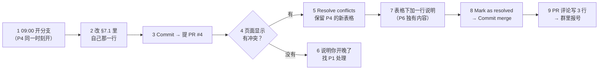

# P6 焦名远 · 任务卡

| 项 | 内容 |
|---|---|
| 你负责 | 制造并解决一次真实的合并冲突，并在 README 留下冲突记录 |
| 分支 | `feature/p6-conflict` |
| 改哪个文件 | `README.md`（只改 §7.1 那一节） |
| 提交信息（逐字复制） | `docs(readme): 补 P6 贡献说明并解决与 §7.1 的合并冲突` |
| 耗时 | 20 分钟 |
| 什么时候做 | **11/22 上午 09:00 开分支**（必须和 P4 张超明同时开，早一步晚一步都会失败） |
| 提交次数 | 1 次（含 1 个 merge commit） |

---

## 一、你的流程



**这一步的意义**：课程 Git 30% 明确要求「成功处理了合并冲突并有相关记录」。你和 P4 改同一张表，就是为了撞出一次真实冲突——不是演的，是两个分支真的动了同一行。

---

## 二、操作步骤

### 步骤 1 · 09:00 准时开分支

```text
打开 https://github.com/NULLFALSE-tech/Algorithm-graph/branches
→ 右上绿色按钮 New branch
→ 输入 feature/p6-conflict → Create new branch
```

⚠️ **开分支的这一刻，P4 的 PR 必须还没合并。** 开之前先看一眼
`https://github.com/NULLFALSE-tech/Algorithm-graph/pulls`，
如果 `feature/readme-team` 那个 PR 已经显示 Merged，说明你晚了——这时停手，直接找 P1，不要自己想办法，否则做出来没有冲突记录。

### 步骤 2 · 改自己那一行

```text
https://github.com/NULLFALSE-tech/Algorithm-graph/blob/feature/p6-conflict/README.md
→ 右上角铅笔图标 → Ctrl+F 搜 P6 焦名远
```

找到这一行（旧表里的原样）：

```text
| P6 | 焦名远 | 自检加 2 项：图片引用有效性 / 需求文档六块齐全 | `tools/verify.py` |
```

改成这一行（只改「第二阶段任务」和「目标文件」两格）：

```text
| P6 | 焦名远 | 自检加 2 项，并负责本节分工表的合并冲突处理与记录 | `tools/verify.py`、`README.md` §7.1 |
```

### 步骤 3 · 提交并提 PR

```text
滚到页面底部 → Commit changes
第一行填：docs(readme): 补 P6 贡献说明并解决与 §7.1 的合并冲突
⚠ 确认勾选 "Commit directly to the feature/p6-conflict branch"
→ Commit changes → Compare & pull request → 标题填同一句 → Create pull request
```

### 步骤 4 · 确认冲突出现

PR 页面往下滚，应该看到红色提示 `This branch has conflicts that must be resolved`，下面一行 `README.md` 旁边有 **Resolve conflicts** 按钮。

- **看到了** → 进步骤 5
- **没看到** → 说明你开分支时 P4 已经合并了，你的改动基于新表，撞不上。这时**停下来找 P1**，不要自己造冲突。

### 步骤 5 · 网页解决冲突

```text
点 Resolve conflicts
```

编辑器里会出现这种标记：

```text
<<<<<<< feature/p6-conflict
| P6 | 焦名远 | 自检加 2 项，并负责本节分工表的合并冲突处理与记录 | `tools/verify.py`、`README.md` §7.1 |
=======
| P6 | 焦名远 | 补自己的贡献说明并解决与本节表格的合并冲突 | docs(readme): 补 P6 贡献说明并解决与 §7.1 的合并冲突 |
>>>>>>> main
```

**处理方式**：只保留 `=======` 下面那一行（P4 的新表是 4 列，结构更规范），把三行标记 `<<<<<<<`、`=======`、`>>>>>>>` 全部删掉。同时确认整张表已经是 P4 的 4 列新表——如果上面几行还是旧的 4 列「目标文件」，说明你按错了，把它换成 P4 的新表。

### 步骤 6 · 在表格下面加一行说明（这是你独有的内容，别省）

在 §7.1 表格下面空一行，粘贴这一句：

```text
> 本节表格结构与提交信息由 P4 在 PR #3 重构；P6 在 PR #4 合并时解决了一次真实冲突，保留 P4 的结构并补入本条说明。
```

⚠️ 这一句必须有。否则你解决冲突后文件内容与 main 完全一致，GitHub 会显示 `no changes`，PR 直接失效。

### 步骤 7 · 完成合并

```text
右上角 Mark as resolved → Commit merge
回到 PR 页面
```

### 步骤 8 · 写 3 行说明（PR 评论框）

```text
冲突位置：README.md §7.1 第二阶段分工表，P6 那一行
原因：P4 的 PR #3 与 P6 的 PR #4 同时修改了同一行，P4 先合并
解决：保留 P4 的 4 列表格结构，把我的描述并入 P6 行，并在表下补充说明
```

点 **Comment**。然后群里报一句：PR #4 已提，冲突已解决。

---

## 三、可复制给 AI 的提示词

写 PR 评论那 3 行如果卡住，用这段：

```text
我刚用 GitHub 网页解决了一次 Markdown 表格的合并冲突，需要写 3 行 PR 说明。

情况：我（P6 焦名远）在 README.md 的 §7.1「第二阶段分工」表里，给自己那一行补了贡献描述；
同时 P4 张超明把这个表整体换成了新口径，他的 PR 先合并了。
我的分支基于旧表，提交后 PR 显示 This branch has conflicts。
我用网页 Resolve conflicts 解决：保留 P4 的新表格结构，把我的描述并入 P6 那一行，并在表格下方加了一行说明。

要求你输出恰好 3 行，每行格式为「标签：内容」，标签固定为 冲突位置 / 原因 / 解决。
每行不超过 40 字，不用第一人称，不用「我认为」，不解释 Git 原理。
```

---

## 四、自己检查（提 PR 前逐条过）

| # | 怎么查 | 通过标准 |
|---|---|---|
| 1 | PR 页面有没有红色 `This branch has conflicts` | 有（没有就是开晚了，找 P1） |
| 2 | 解决后表格 | 4 列：代号 / 姓名 / 第二阶段任务 / 本次提交；6 行 P1–P6 |
| 3 | 表格下面那行 `> 本节表格结构…` | 存在，这是保证 PR 有 diff 的关键 |
| 4 | 页面有没有 `<<<<<<<`、`=======`、`>>>>>>>` 残留 | 搜一下，一个都不能留 |
| 5 | PR 评论 | 恰好 3 行，标签是 冲突位置 / 原因 / 解决 |
| 6 | 除了 §7.1，README 别处有没有变 | 不该变 |

---

## 五、验收提示词（把 PR 页面文字贴给 AI）

```text
你是课程作业的验收员。下面是一次 Pull Request 的内容摘要（含冲突提示、解决后的文件片段、评论）。逐条检查，给 PASS 或 FAIL。

1. 这个 PR 必须曾经出现过合并冲突（页面出现过 This branch has conflicts that must be resolved），且已被解决。看不出冲突痕迹即 FAIL。
2. 解决后的表格必须是 4 列：代号 | 姓名 | 第二阶段任务 | 本次提交，且是 6 行 P1–P6。列数不对或行数不对即 FAIL。
3. 文件里不许残留任何一处 `<<<<<<<`、`=======`、`>>>>>>>`。有残留即 FAIL，指出位置。
4. 表格下方必须有一行以 `>` 开头的引用块，内容包含「P4」「P6」「冲突」三个词。缺失即 FAIL。
5. PR 评论必须恰好 3 行，每行以「冲突位置：」「原因：」「解决：」开头。行数不对或标签不对即 FAIL。
6. 提交信息必须是 `docs(readme): 补 P6 贡献说明并解决与 §7.1 的合并冲突`，有一个字不同即 FAIL。

输出格式：一张 3 列表格「条目 | 结果 | 问题位置」，最后一行写「PASS n 条，FAIL m 条，结论：可提交 / 需返工」。
不要复述标准。
```
