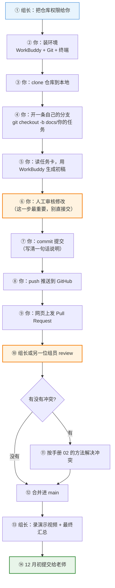
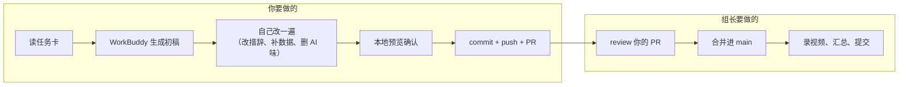

# 组员手册 00 · 总览与流程图

> 给 13 班 6 组的 5 位组员：**王瑞（P2）、郭子琪（P3）、张超明（P4）、吴家溢（P5）、焦明远（P6）**
> 组长：邓宇轩（P1，负责仓库、代码、演示视频、最终合并）
> 交付期限：**2026 年 12 月初**
> 你只需要读完这一份 + 你名字对应的那张任务卡，就能开工。

---

## 一、这个项目现在是什么状态

一句话：**程序已经做完、能跑，缺的是「文档补两块」和「每个人留下自己的提交记录」。**

| 已经完成 | 还缺什么 | 谁补 |
|---|---|---|
| 76 个算法的数据、C 源码、87 张原理图 | 需求文档「知识原理」一章 | P2 王瑞 |
| Python 程序（5 个模块，零第三方依赖） | 需求文档「可视化设计」一章 | P3 郭子琪 |
| 首页图谱、列表页、搜索、详情页、源码高亮 | README「主要功能」一节 + 定位替换 | P4 张超明 |
| 12 项自检脚本、10 个单元测试 | 演示视频的**脚本**（视频组长录） | P5 吴家溢 |
| 34 个提交、11 条分支、1 次真冲突 | 自检脚本再加 2 项（图片有效性、文档六块） | P6 焦明远 |

**重要**：程序部分**不需要你写代码**。你们五个人做的都是**文档 + 少量配置**，用 AI 工具生成初稿，你负责判断和修改。

---

## 二、老师到底要什么（先搞清标准，再动手）

老师课堂上讲了 5 项交付物和 4 块评分，摘成一张表：

| 交付物 | 要求 | 我们现在的状态 |
|---|---|---|
| ① 仓库链接 | 公开，或有权限给老师 | ✅ 已公开 |
| ② 项目需求文档 | Markdown，**六块结构** | ⚠️ 只有四块，缺两块 |
| ③ AI 提示词日志 | **3 次交互 × 3 要素**（提示词 / AI输出 / 人工修改） | ✅ 已完成，且写得很扎实 |
| ④ 源代码 | `.py` 文件 | ✅ 已完成 |
| ⑤ README | 五段：简介 / 安装运行 / Git 链接+分支+冲突 / 截图 / **主要功能** | ⚠️ 缺「主要功能」 |

| 评分维度 | 占比 | 看什么 |
|---|---|---|
| 文档规范 | 20% | 标题、列表、表格、图片、代码块 |
| **协作流程** | **30%** | 提交记录、分支隔离、**冲突处理记录** |
| AI 应用 | 25% | AI 日志详实、**能发现并纠正 AI 的错误** |
| 程序实现 | 25% | 能跑、无 Bug、界面友好 |

**结论**：你们五个人的活儿，直接对应「文档规范 20%」和「协作流程 30%」这两块 —— **合计 50 分**，比程序本身还值钱。

---

## 三、整体流程图（照着走）



> 图里**橙色两步**是老师打分的重点：⑥「人工审核修改」= AI 应用 25% 里的「能纠正 AI 错误」；⑩「review」= 协作 30% 里的「Code Review」。

---

## 四、五个人各干什么（一句话版）

| 代号 | 姓名 | 一句话任务 | 改哪个文件 | 提交次数 |
|---|---|---|---|---|
| **P2** | 王瑞 | 给需求文档补一章「知识原理」 | `docs/Project_Requirements_and_Design.md` | ≥ 2 次 |
| **P3** | 郭子琪 | 给需求文档补一章「可视化设计」 | 同上（接在 P2 后面） | ≥ 2 次 |
| **P4** | 张超明 | 给 README 补「主要功能」+ 改项目定位 | `README.md` | ≥ 2 次 |
| **P5** | 吴家溢 | 写演示视频脚本 + 做全组提交规范巡检 | `docs/演示脚本.md`（新建） | ≥ 2 次 |
| **P6** | 焦明远 | 给自检脚本加 2 项检查 | `tools/verify.py` | ≥ 2 次 |

**为什么每人至少 2 次提交**：老师要看「6 个人先后提交」的痕迹。1 次提交 + 1 次修改补提交 = 2 次，正好体现「改了一版又调了」。**不要一次推完所有内容。**

---

## 五、时间表（12 月初交，不赶）

| 阶段 | 时间 | 做什么 | 谁 |
|---|---|---|---|
| **第 1 天** | 11/18 前 | 装环境、clone 仓库、跑通 `python tools/whoami.py` 看到自己名字 | 全体 |
| **第 2–4 天** | 11/18–11/20 | 交**第一版**（骨架，不用完美），commit + push + 发 PR | 全体 |
| **第 5–7 天** | 11/21–11/23 | 组内 review，按意见改**第二版**，再 commit | 全体 |
| **第 8–10 天** | 11/24–11/26 | 组长合并全部 PR，跑全量自检 | P1 |
| **第 11–14 天** | 11/27–11/30 | 组长录演示视频，全员最后校对 | P1 + 全体 |
| **截止前** | 12/1–12/5 | 仓库链接 + 视频 + 选题表 提交 | P1 |

> 分两版交（骨架 → 完善）不是拖延，是**故意制造两次提交**，让 Git 记录看起来像真实迭代。

---

## 六、三份配套手册（按顺序读）

| 手册 | 什么时候读 | 解决什么问题 |
|---|---|---|
| **01 · 环境准备** | 第一天，动手之前 | WorkBuddy 怎么下载、终端怎么开、Git 怎么装、GitHub 账号怎么加进仓库 |
| **02 · Git 协作** | 写完第一版要提交时 | 六条命令、怎么发 PR、冲突了怎么办、怎么留 review 记录 |
| **03 · 任务卡** | 动手写内容时 | 你那张卡的详细要求、提示词、验收命令 |

**读的顺序**：00（本文件）→ 01 → 03（先看自己要写什么）→ 02（要提交时再回来看）。

---

## 七、五条铁律（违反了会扣分）

| # | 铁律 | 为什么 |
|---|---|---|
| 1 | **不许直接改 `main` 分支** | 老师要看「分支隔离」，全推到 main 这条就废了 |
| 2 | **每次提交只改自己负责的文件** | 改别人的文件会造成冲突，且贡献记录混乱 |
| 3 | **不许把绝对路径写进文档**（如 `C:\Users\xxx\...`） | 老师电脑上打不开图，这是他在课上专门强调的 |
| 4 | **AI 生成的初稿必须自己改过再交** | 老师明确扣「盲目复制粘贴」的分 |
| 5 | **图片必须放仓库里、用相对路径引用** | 外链图床和绝对路径都会在他电脑上裂掉 |

---

## 八、卡住了怎么办

| 情况 | 找谁 | 怎么找 |
|---|---|---|
| 装不上环境、命令报错 | **先在群里问**，同组成员大概率遇到同一个坑 | 群里发报错截图 |
| 卡超过 30 分钟 | **找 P4 张超明**（先遣员，他先踩过一遍） | 私聊 + 截图 |
| P4 也解决不了 | **找组长 P1** | 私聊，附上：你想做什么 + 打了什么命令 + 完整报错 |
| 不知道该写什么内容 | 看**手册 03 你那张卡** | 里面有逐条要求 |

> ⚠️ 问人的时候，一定带上三样：**我想做什么 / 我输入了什么 / 报错原文**。只说「不行了」没人能帮你。

---

## 九、完成标准（怎么知道自己这关过了）

你这张卡算完成，要同时满足四条：

1. ✅ 文件里能看到你写的内容（不是空壳）
2. ✅ `git log --author="你的名字" --oneline` 有 **≥ 2 条**记录
3. ✅ 你的分支已经通过 PR 合并进 `main`
4. ✅ 任务卡里「验收命令」全部通过

自查命令（在仓库目录下打开终端跑）：

```bash
git log --author="王瑞" --oneline          # 换成你自己的名字
git log --oneline --graph --all | head -30  # 看分支拓扑
python tools/verify.py                      # 全组自检，应该 PASS
```

---

## 十、一张图记住你要做的事



---

**下一步**：打开 `组员手册_01_环境准备.md`，把环境装好。装完能跑出下面这条命令的输出，就算过关：

```bash
python tools/whoami.py
```

看到自己名字和负责的章节，就可以开始写内容了。
