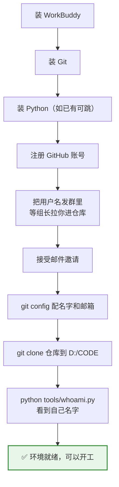

# 组员手册 01 · 环境准备（WorkBuddy + Git + 终端 + GitHub）

> 目标：**30–60 分钟内**，让你的电脑具备「改文件 → 提交 → 推送」的能力。
> 全部做完，你应该能跑出这条命令并看到自己的名字：
> ```bash
> python tools/whoami.py
> ```

---

## 一、要装几样东西（先看全貌）

| # | 装什么 | 干什么用 | 多久 | 必须吗 |
|---|---|---|---|---|
| 1 | **WorkBuddy** | 用 AI 生成文档初稿 | 10 min | ✅ 必须 |
| 2 | **Git for Windows** | 版本控制，提交代码 | 10 min | ✅ 必须 |
| 3 | **VS Code**（可选） | 看文件、改文字、开终端 | 10 min | 建议装 |
| 4 | **GitHub 账号** | 团队仓库在这 | 5 min | ✅ 必须 |
| 5 | Python 3.8+ | 跑自检脚本 | 5 min | ✅ 必须（你可能已有） |

> 装完总占用磁盘约 500 MB，都不大。

---

## 二、装 WorkBuddy

### 2.1 下载

1. 打开浏览器，访问官网：**`https://www.workbuddy.cn`**
2. 点「下载」，选 **Windows 版**
3. 如果官网打不开，直接在群里问组长要安装包（他会发在群文件）

### 2.2 安装

双击安装包 → 一路「下一步」→ 装完桌面会出现图标。

**Windows 可能提示「已保护你的电脑」** → 点「更多信息」→「仍要运行」。这是没买数字签名的正常提示，不是病毒。

### 2.3 登录

首次打开会要求登录。用**微信扫码**或**QQ 邮箱**都行。

### 2.4 界面认一下（30 秒）

```
┌─────────────────────────────────────────────┐
│  左侧栏            中间对话区               │
│  ┌────────┐    ┌──────────────────────┐    │
│  │ 新建对话│    │                      │    │
│  │ 历史记录│    │   你在这里打字问 AI   │    │
│  │ 专家    │    │                      │    │
│  └────────┘    └──────────────────────┘    │
│                ┌──────────────────────┐    │
│                │ 输入框（Enter 发送） │    │
│                └──────────────────────┘    │
└─────────────────────────────────────────────┘
```

**你只需要用到一个功能**：新建对话 → 粘提示词 → 它生成内容 → 你复制出来。

### 2.5 一个必须知道的事：它不能自己改你的文件

WorkBuddy 生成的内容显示在对话框里，**不会自动写进你的仓库**。你要：

1. 在对话框里让它输出完整内容
2. **复制**这段内容
3. 粘贴进 VS Code 打开的那个 `.md` 文件
4. 保存（Ctrl+S）

> ⚠️ 如果你看到它说「已帮你写入文件」，一定要回 VS Code **打开那个文件确认**——AI 说的和实际做的可能不一致。

---

## 三、装 Git（Windows）

### 3.1 下载

访问 **`https://git-scm.com/download/win`** → 点「64-bit Git for Windows Setup」。

下载慢的话用国内镜像：**`https://npmmirror.com/mirrors/git-for-windows/`**

### 3.2 安装（一路默认，只有两处要注意）

| 安装步骤 | 选什么 |
|---|---|
| 选择组件 | 默认即可 |
| **默认编辑器** | 改成 **Use Visual Studio Code**（如果你装了 VS Code）；没装就选 **Nano** |
| **PATH 环境** | 选 **Git from the command line and also from 3rd-party software**（默认项） |
| 换行符 | 选 **Checkout Windows-style, commit Unix-style**（默认项） |
| 其余 | 一路 Next |

### 3.3 验证装好了

按 `Win + R`，输入 `cmd`，回车，在黑框里敲：

```bash
git --version
```

看到类似 `git version 2.47.0.windows.1` 就成功了。

---

## 四、命令行终端怎么开（三种方式，任选）

**什么是终端**：就是一个只能打字的黑框，你输入命令、它执行。不用怕，你只会用到 6 条。

### 方式 A：Git Bash（推荐 ⭐）

装完 Git 后，在**任意文件夹空白处右键** → 「**Open Git Bash here**」→ 弹出黑框。

或者在开始菜单搜 **Git Bash** → 打开。

**为什么推荐**：命令和网上教程（Mac/Linux）完全一致，复制粘贴不会出错。

### 方式 B：PowerShell

按 `Win + X` → 选「**终端**」或「**Windows PowerShell**」。

⚠️ PowerShell 的坑：**不支持 `&&` 连接命令**，也不支持 `cd /d`。看到教程里有 `&&` 就分开敲。

### 方式 C：VS Code 内置终端（改文件时最方便）

打开 VS Code → 顶部菜单「终端」→「新建终端」，或按 **Ctrl + `**（Esc 下面那个键）。

底部会弹出一个框，默认就是 PowerShell 或 Git Bash。

> **三条规则**，记住就不会出错：
> 1. **终端有「当前目录」的概念**。敲 `cd 路径` 可以切换。所有 `git` 命令必须在仓库目录里执行。
> 2. **路径带空格要加引号**：`cd "D:\my folder"`。
> 3. **看到 `>` 开头的提示符才能输入**，程序跑着的时候输入没反应是正常的。

---

## 五、GitHub 账号 + 加进仓库

### 5.1 有没有账号

访问 **`https://github.com`**，看右上角：
- 有头像 → 已登录，检查用户名（点头像 → Your profile）
- 显示 Sign in → 点它注册

### 5.2 注册要点（如果没账号）

| 项 | 怎么填 |
|---|---|
| Username | 英文+数字，例如 `wangrui2007`（**记住它，这是你在 Git 里的身份**） |
| Email | 常用邮箱，**后面配 Git 要用同一个** |
| Password | 至少 15 位，或 8 位含数字和小写 |

注册后去邮箱点验证链接，否则不能提交代码。

### 5.3 把用户名发给组长

在群里发给组长：

```
我的 GitHub 用户名：wangrui2007
我的邮箱：xxxxx@qq.com
```

组长会把你加成仓库的 **Collaborator**（协作者）。你会收到一封邮件，点「**Accept invitation**」。

**没收到邮件**：让组长发邀请链接给你，直接在网页上点接受。

### 5.4 验证你被加进去了

访问 **`https://github.com/NULLFALSE-tech/Algorithm-graph`**，能看到仓库内容 = 成功。

---

## 六、配置 Git 身份（关键，配错就白提交）

### 6.1 为什么要配

每次提交，Git 会记下「谁提交的」。这个信息来自你电脑上的配置，**不是 GitHub 账号自动带过来的**。配错了，你的提交会显示成别人的名字，或者 `unknown`。

### 6.2 两行命令

打开终端（Git Bash），**原样敲**，把引号里的换成你自己的：

```bash
git config --global user.name "王瑞"
git config --global user.email "你的GitHub邮箱@qq.com"
```

> ⚠️ 两个坑：
> 1. **`user.name` 填中文真名**（老师要看谁做的），不是 GitHub 用户名。
> 2. **`user.email` 必须和 GitHub 账号邮箱一致**，否则 GitHub 不认这是你，头像不会显示，贡献记录也不算你的。

### 6.3 检查配对了没

```bash
git config --global user.name
git config --global user.email
```

能打印出你刚填的内容就对了。

---

## 七、把仓库下载到本地（clone）

### 7.1 先建个专门放代码的文件夹

建议 `D:\CODE\`（不要放桌面，路径带中文容易出问题）。

```bash
cd /d/CODE
```

### 7.2 克隆

```bash
git clone https://github.com/NULLFALSE-tech/Algorithm-graph.git
```

看到类似下面的输出就成功了：

```
Cloning into 'Algorithm-graph'...
remote: Enumerating objects: 195, done.
Receiving objects: 100% (195/195), done.
```

### 7.3 进去看看

```bash
cd Algorithm-graph
ls
```

应该能看到：`README.md`、`app.py`、`docs/`、`eg/`、`data/`、`tools/` 等。

### 7.4 如果 clone 失败

| 报错 | 原因 | 解决 |
|---|---|---|
| `Could not resolve host: github.com` | 网络/DNS | 换手机热点再试；或用下面的 SSH 方案 |
| `Connection was reset` / `Failed to connect to github.com port 443` | 443 端口被墙 | 用 **SSH over 443**（见 7.5） |
| `Authentication failed` | 需要登录 | 见 7.6 |

### 7.5 SSH over 443（HTTPS 连不上时用这个）

*说明：这不是翻墙，是把 SSH 走 443 端口，属于正常网络配置。老师课上明确说过别用校园网翻墙，这个方法不涉及任何代理软件。*

```bash
# 1. 生成密钥（一路回车，密码可以不设）
ssh-keygen -t ed25519 -C "你的邮箱@qq.com"

# 2. 看公钥内容，整段复制
cat ~/.ssh/id_ed25519.pub
```

3. 打开 GitHub → 右上角头像 → **Settings** → 左侧 **SSH and GPG keys** → **New SSH key** → 粘贴 → Add

4. 让 SSH 走 443：

```bash
# 在 ~/.ssh/config 里加这三行（文件不存在就新建）
Host github.com
  HostName ssh.github.com
  Port 443
```

```bash
# 5. 测试
ssh -T git@github.com
# 看到 "Hi 你的用户名! You've successfully authenticated" 就成功

# 6. 把仓库地址改成 SSH
cd Algorithm-graph
git remote set-url origin git@github.com:NULLFALSE-tech/Algorithm-graph.git
```

### 7.6 HTTPS 每次都要输密码？

GitHub 从 2021 年起不能用账号密码，要用 **Personal Access Token（PAT）**：

1. GitHub → 头像 → Settings → 最下面 **Developer settings** → **Personal access tokens** → **Tokens (classic)** → **Generate new token**
2. 勾选 **`repo`** 权限，有效期选 90 天
3. 生成后**立刻复制**（只显示一次）
4. 下次 `git push` 提示输密码时，**粘贴这个 token**（不是你的登录密码）

---

## 八、跑通第一条命令（验收环境）

在仓库目录下：

```bash
python tools/whoami.py
```

### 预期输出

```
P2 · 王瑞 · 需求 · 第二部分 功能与数据
  负责章节: chapter_array_and_linkedlist, chapter_stack_and_queue, chapter_hashing
  算法条数: 13
  ...
```

### 如果报错

| 报错 | 解决 |
|---|---|
| `python 不是内部或外部命令` | Python 没装或没加到 PATH。去 `python.org` 装 3.12/3.13，安装时**勾选 Add Python to PATH** |
| `No such file or directory: tools/whoami.py` | 你不在仓库目录里。先 `cd` 到 `Algorithm-graph` 文件夹 |
| 中文显示乱码 | 在终端敲 `chcp 65001` 切 UTF-8 |
| `ModuleNotFoundError` | 你跑错目录了，必须在仓库根目录 |

---

## 九、装完自检清单

全部打勾才算环境就绪：

- [ ] `git --version` 有输出
- [ ] `git config --global user.name` 打印出**你的真名**
- [ ] `git config --global user.email` 打印出**GitHub 注册邮箱**
- [ ] 能访问 `https://github.com/NULLFALSE-tech/Algorithm-graph` 并看到内容
- [ ] `D:\CODE\Algorithm-graph` 文件夹存在，里面有 `README.md`
- [ ] `python tools/whoami.py` 能看到自己的名字
- [ ] WorkBuddy 能登录、能新建对话

---

## 十、下一步

环境好了，去看**手册 03** 里你名字对应的那张任务卡，开始写内容。

写完要提交时，回来看**手册 02**。

---

## 附：一张图记住整个流程


