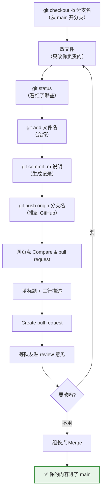

# 组员手册 02 · Git 协作（六条命令 + PR + 冲突）

> 目标：把你写好的内容**变成一条能被老师看见的提交记录**。
> 全程只用到 6 条命令，背下来最好，背不下来就复制。

---

## 一、先理解一件事：为什么不能直接改 main

老师评分里「协作流程」占 **30%**，看的是三样：

1. 提交记录（commit log）清晰规范
2. **正确使用了分支隔离开发**
3. 成功处理合并冲突并有记录

如果你直接在 `main` 上改、直接推——**第 2 条就是 0**。所以每个人都必须走：

```
开分支 → 改文件 → 提交 → 推到自己的分支 → 发 PR → 别人 review → 合并
```

一条分支 = 一个「任务空间」。你在自己空间里怎么改都不影响别人。

---

## 二、六条命令（全部你要用的）

| #   | 命令                     | 干什么        | 什么时候用     |
| --- | ---------------------- | ---------- | --------- |
| 1   | `git checkout -b 分支名`  | 开一条新分支并切过去 | 开工第一步     |
| 2   | `git status`           | 看有哪些文件被改了  | 每次提交前     |
| 3   | `git add 文件名`          | 把改动放进「待提交」 | 提交前       |
| 4   | `git commit -m "说明"`   | 真正提交，生成记录  | 一次改完      |
| 5   | `git push origin 分支名`  | 推到 GitHub  | 提交之后      |
| 6   | `git pull origin main` | 拉取别人的最新改动  | 合并前 / 冲突时 |
|     |                        |            |           |

> 还有一条救命命令，**任何一步卡住都先跑它**：
> ```bash
> git status
> ```
> 它会告诉你「你现在在哪条分支、哪些文件改了、下一步该干什么」。

---

## 三、完整流程（照着敲）

### 第 0 步：确认在仓库目录、在 main 上，而且是最新的

```bash
cd /d/CODE/Algorithm-graph
git checkout main        # 确保你在 main 上
git pull origin main     # 把别人已经合并的改动拉下来（这步不能省）
git status
```

应该看到：`On branch main` + `nothing to commit, working tree clean`

**如果显示 `not a git repository`** → 你不在仓库目录里，`cd` 回去。

> ⚠️ **`git pull` 这步千万别省**。你基于三天前的 main 开分支，别人这几天合并的东西你都没有，
> 等你最后合并时必然多撞一次冲突。**开工前先同步**，这是最省事的习惯。

---

### 第 1 步：开自己的分支

分支名用「任务类型/任务名」：

| 你的任务 | 分支名 |
|---|---|
| P2 知识原理 | `docs/knowledge-principle` |
| P3 可视化设计 | `docs/visual-design` |
| P4 README 主要功能 | `docs/readme-features` |
| P5 演示脚本 | `docs/video-script` |
| P6 自检补强 | `feat/verify-extra` |

```bash
git checkout -b docs/knowledge-principle
```

看到 `Switched to a new branch 'docs/knowledge-principle'` 就对了。

**验证**：

```bash
git branch
```

你那条分支前面会有个 `*`。

---

### 第 2 步：改文件

用 VS Code 打开仓库文件夹，改你负责的那个文件。

> ⚠️ **只改你负责的文件**。改别人的文件会造成冲突，而且贡献记录会混乱。

改完**先本地预览**：

- Markdown 文件：VS Code 里按 **Ctrl + Shift + V** 看排版效果
- 图片能不能显示：预览里看得到 = 路径对

---

### 第 3 步：看改了什么

```bash
git status
```

你会看到红色的一行：

```
modified:   docs/Project_Requirements_and_Design.md
```

红色 = 改了但还没提交。

想具体看改了什么：

```bash
git diff docs/Project_Requirements_and_Design.md
```

---

### 第 4 步：加入待提交

```bash
git add docs/Project_Requirements_and_Design.md
```

再跑 `git status`，那行会变成**绿色** `Changes to be committed`。

> 只提交你改的那个文件。**不要用 `git add .`** —— 那会把所有乱七八糟的东西都加进去（包括你不小心建的临时文件）。

---

### 第 5 步：提交

```bash
git commit -m "docs(需求): 补第二章知识原理（复杂度与存储结构）"
```

### commit 说明怎么写（老师会看）

格式：`类型(范围): 一句话做了什么`

| 类型 | 用在哪 |
|---|---|
| `docs` | 改文档 |
| `feat` | 加新功能 |
| `fix` | 修 bug |
| `test` | 加测试 |
| `chore` | 杂活（配置、脚本） |

**好的写法**：
- `docs(需求): 补第二章知识原理（复杂度与存储结构）`
- `docs(README): 补主要功能说明，搬 F1-F7`
- `test(verify): 新增图片引用有效性校验`

**差的写法**（会被扣分）：
- ❌ `update`
- ❌ `改了一下`
- ❌ `111`
- ❌ `finally`

> 一句话原则：**看这句话，就知道你干了什么**。

---

### 第 6 步：推到 GitHub

```bash
git push origin docs/knowledge-principle
```

第一次推会提示要密码 → 粘贴你的 **Personal Access Token**（见手册 01 第 7.6 节）。

成功的样子：

```
 * [new branch]      docs/knowledge-principle -> docs/knowledge-principle
```

---

### 第 7 步：发 Pull Request（PR）

1. 打开 `https://github.com/NULLFALSE-tech/Algorithm-graph`
2. 页面顶部会出现一个黄色横条：**「docs/knowledge-principle had recent pushes」** → 点右边的 **「Compare & pull request」**
3. 填两个框：
   - **标题**：和你 commit 说明一样
   - **描述**：写三行
     ```
     改了什么：补了需求文档第二章「知识原理」
     为什么改：老师要求六块结构，原文档只有四块
     怎么验证：Ctrl+Shift+V 预览排版正常，图和表格都能显示
     ```
4. 点绿色 **「Create pull request」**

**没看到黄色横条**？手动来：仓库页 → **Pull requests** 标签 → **New pull request** → 左边选 `main`，右边选你的分支。

---

### 第 8 步：等队友贴 review 意见

队友会在你的 PR 上留评论——评论内容由他的 AI 按第六节的方法生成，他负责粘上去。

**看到意见后怎么改**：把意见原文和自己的那一版一起交给 AI，让它出修改稿；然后在你本地那条分支上 `add` → `commit` → `push`，PR 会自动更新。不用重新发 PR。

---

### 第 9 步：合并

review 通过后，由**组长**点 **「Merge pull request」**。

⚠️ **你不要自己点合并**（除非组长让你点）。原因：老师要看「别人 review 后合并」的痕迹。

---

## 四、完整流程图



---

## 五、冲突了怎么办（不要慌）

### 5.1 冲突长什么样

如果别人先合并了改动，而你们改了**同一个文件的同一块地方**，合并时 GitHub 会显示：

> ⚠️ **This branch has conflicts that must be resolved**

或者你本地 `git pull origin main` 后，文件里出现这种东西：

```
<<<<<<< HEAD
这里是 main 上的内容
=======
这里是你分支上的内容
>>>>>>> docs/knowledge-principle
```

### 5.2 三步解决

**第 1 步**：在本地把 main 的最新内容拉下来

```bash
git checkout main
git pull origin main
git checkout 你的分支名
git merge main
```

**第 2 步**：VS Code 打开冲突文件，你会看到这样的界面：

```
┌─────────────────────────────────────┐
│  Accept Current Change              │  ← 保留你的
│  Accept Incoming Change             │  ← 保留 main 的
│  Accept Both Changes                │  ← 两个都要
│  Compare Changes                    │  ← 并排对比
└─────────────────────────────────────┘
```

**选哪个**：看内容判断。
- 两人改的是**不同内容** → 选 **Accept Both Changes**（两个都留）
- 两人改的是**同一处** → 对比后留对的那个

**第 3 步**：删掉 `<<<<<<<`、`=======`、`>>>>>>>` 这三行标记（选了 Accept 后 VS Code 会自动删），保存。

然后：

```bash
git add 冲突的文件
git commit -m "merge: 解决 main 与 docs/xxx 的冲突（保留双方改动）"
git push origin 你的分支名
```

### 5.3 解决冲突的说明要写清

老师要看「冲突处理记录」。所以：

1. commit 说明里写清哪两个分支冲突
2. PR 描述里加一段：

```
## 冲突解决
- 冲突文件：docs/Project_Requirements_and_Design.md
- 冲突原因：P2 和 P3 都要在目录表的相邻两行各加自己那一行
- 解决方式：两行不是同一个单元格，无语义冲突，**两行都保留**，按章节号排序
```

> 这一段就是「协作 30%」里最容易拿分的地方——**它证明你真的处理过冲突，而不是回避了它**。

---

## 六、给别人的 PR 留 review（每人至少做一次）

老师要看「Code Review」记录。评论内容由 AI 生成，你只负责挑段落、粘贴。

### 6.1 取被审的内容

1. 打开仓库 → **Pull requests** 标签 → 点开别人的 PR
2. 点 **Files changed**
3. 把带绿底（新增）或红底（删除）的那几段**整段复制**下来。文件长的话，只复制他这次改的部分

### 6.2 让 AI 出评论（整段复制下面的提示词）

```text
下面是一位同学提交的 Git 变更片段。请以代码审查者的身份，找出 1 到 3 处具体问题，输出成可以直接粘贴到 GitHub PR 的行内评论。

约束：
1. 每条评论必须给出三样：位置（第几行或哪个标题下）、问题是什么、改成什么；
2. 每条不超过两句话，不要写「写得好」「继续加油」这类客套；
3. 只依据下面这段文字判断，不要推测运行结果、不要臆测作者意图；
4. 找不出内容问题时，允许提格式问题（标题层级跳级、缺空行、中英文之间没空格、表格列数不齐），并指明是哪一行；
5. 不要提「建议增加更多内容」这种无法验收的意见。

输出格式：直接给评论正文，多条之间空一行，不要加序号以外的解释。

【变更片段】
（在这里粘贴上一步复制的内容）
```

### 6.3 把评论贴到 PR

1. 回到 **Files changed**
2. 鼠标移到 AI 指出的那一行，左边出现蓝色 `+` → 点它
3. 粘贴对应那条评论 → 点 **Start a review**
4. 右上角 **Finish your review** → 选 **Comment** → **Submit review**

> 找不到对应行（比如 AI 提的是整份文档的结构问题）→ 用 **Conversation** 标签最下面的评论框，直接贴，效果一样，老师看得到。

**至少贴一条。** 一条都没有的 PR，在「协作 30%」里等于你没参与过 review。

---

## 七、每个人必须留下的证据（老师会查）

| 证据 | 怎么产生 | 老师在哪看 |
|---|---|---|
| ≥ 3 次提交 | 三轮「初稿 → 复核修改稿 → 补漏」各 commit 一次 | `git log --author="你的名字"` |
| 1 条自己的分支 | `git checkout -b` | 仓库 Branches 页 |
| 1 个自己的 PR | 网页发 PR | Pull requests 页 |
| 1 次 review 别人 | 在别人 PR 留评论 | PR 评论区 |
| 1 条冲突处理记录（**至少一人**） | 解决一次冲突并写说明 | commit 说明 + PR 描述 |

---

## 八、常见报错对照表

| 报错 | 原因 | 解决 |
|---|---|---|
| `not a git repository` | 不在仓库目录 | `cd /d/CODE/Algorithm-graph` |
| `Your local changes would be overwritten` | 有未提交的改动 | 先 `git add` + `git commit`，或 `git stash` 暂存 |
| `Updates were rejected because the remote contains work` | 远端有你本地没有的提交 | `git pull origin 你的分支名` 再 push |
| `Please tell me who you are` | 没配 user.name/email | 回手册 01 第六节配 |
| `Authentication failed` | 密码用了登录密码 | 用 Personal Access Token |
| `Permission denied (publickey)` | SSH 密钥没配 | 回手册 01 第 7.5 节，或改用 HTTPS |
| `error: pathspec 'xxx' did not match` | 文件名打错或路径不对 | `ls` 看一下真实文件名，中文名要引号包起来 |
| `detached HEAD` | 切到了某个提交而不是分支 | `git checkout main` 回来 |
| push 后网页看不到分支 | 推错名字 | `git branch` 看你真实分支名，重新 `git push origin 真实分支名` |

---

## 九、三件事千万别做

| ⛔ 别做 | 为什么 |
|---|---|
| **`git push --force`** | 会覆盖别人的提交，可能把整组的工作抹掉 |
| **`git reset --hard`** | 会丢掉你所有未提交的改动，且找不回来 |
| **直接改 `main` 然后 push** | 分支隔离这一项直接判 0，30 分里丢一大块 |

如果手滑做了上面某一件，**立刻停手，在群里说**，别自己再试别的命令。

---

## 十、提交前的最后检查（30 秒）

```bash
git status                      # 只应该有你要改的那一个文件
git diff --stat                 # 看改动行数，别是几千行（那说明改错文件了）
```

再确认三件事：

- [ ] 分支名不是 `main`
- [ ] commit 说明能看懂干了什么
- [ ] 没有提交 `__pycache__`、`.exe`、临时文件

第三条如果不确定，跑：

```bash
git status --short
```

看到 `?? __pycache__/` 之类就说明没被忽略——联系组长，别自己删 `.gitignore`。
