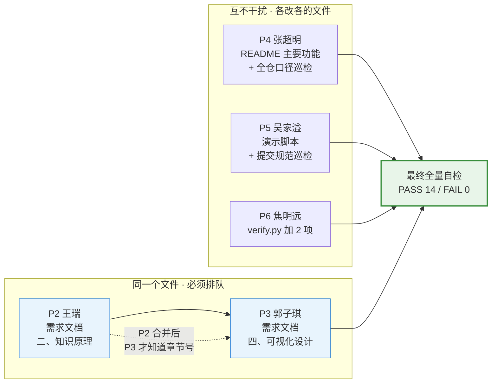

# 组员手册 03 · 任务卡（P2–P6）

> 这份是**干活用的**，不是读的。只看自己那一段。
> 读的顺序：先 `00_总览与流程图` 搞清全貌 → 再读属于你的那张卡 → 卡在装环境翻 `01`，卡在 Git 翻 `02`。

---

## 一、五张卡的关系（谁挡着谁）



**只有 P2 和 P3 改同一个文件**（`docs/Project_Requirements_and_Design.md`）。其余三张卡各改各的，互不冲突。

> ⚠️ P3 你可以不等 P2。两个人同时改一个文件，Git 一定会在「目录」那几行撞车 —— **撞了不用怕，按手册 02 第六节解决就行**。这甚至是对你有利的：老师要的「成功处理合并冲突并有记录」，就是这么自然产生的，不需要造假。

---

## 二、P2 王瑞 · 需求文档补「二、知识原理」

### 2.1 为什么要有这一章

老师给的六块需求文档结构里，第 ② 块就是「知识原理」：**你不讲清楚这门课的知识是什么，就没法证明你的图谱分组是有依据的**。现在文档只有「背景与目标」「功能与数据」「技术方案」，中间缺了「凭什么这么分」。

### 2.2 你要交什么

| 项 | 内容 |
|---|---|
| 改哪个文件 | `docs/Project_Requirements_and_Design.md` |
| 改哪里 | 在现「## 二、功能与数据」**前面**插入新的一章 |
| 字数 | 1200–1500 中文字（不含代码块和表格） |
| 提交次数 | **至少 2 次**（先交一半，再补完） |

同时你必须做**章节重编号**（因为插了一章，后面的序号要顺延）：

| 原编号 | 新编号 |
|---|---|
| 一、背景与目标 | 一、背景与目标（不动） |
| 二、功能与数据 | **三、主要功能与数据** |
| 三、技术方案与验收 | **五、技术方案与验收** |
| 附：小组分工 | **六、团队分工** |

> 「四、可视化设计」这个号**留给 P3**，你不要占。你插完「二」之后，「三」后面就是空的，等 P3 填「四」。
> 重编号时**目录那块（第 15–27 行）也要一起改**，别忘了。

### 2.3 这一章必须写到的四件事

**① 算法复杂度：怎么衡量「快」和「省」**

- 大 O 记号的定义：描述的是**增长趋势的上界**，不是精确耗时
- 为什么可以忽略常数和低阶项（举例：`3n² + 5n + 100` 为什么记作 `O(n²)`）
- 时间复杂度和空间复杂度分别指什么
- 常见量级的排序（从快到慢）：`O(1)` < `O(log n)` < `O(n)` < `O(n log n)` < `O(n²)` < `O(2ⁿ)` < `O(n!)`
- 各举一个本项目里真实存在的例子（比如二分查找是 `O(log n)`、冒泡排序是 `O(n²)`）——**例子必须能在 `data/algos.json` 里查到，不许自己编**

**② 两种存储结构：顺序 vs 链式**

- 顺序存储（数组）：内存连续、靠下标算地址，所以**随机访问 O(1)**；但中间插入/删除要挪元素，**O(n)**
- 链式存储（链表）：节点散在内存里、靠指针串起来，**访问第 k 个要顺着走 O(n)**；但已知位置时插入/删除只改指针，**O(1)**
- 一句话总结这个权衡：**「用空间连续性换访问速度，或用指针灵活性换插入速度」**
- 顺带说清栈、队列、哈希表分别建立在这两种之上（栈/队列可以是数组也可以是链表；哈希表底层是数组 + 冲突处理）

**③ 本项目 5 层划分的依据**

- 打开 `data/layers.json`，**照抄真实的层名**，不许自己起名。真实层名是这五个：
  `第 0 层 · 度量` / `第 1 层 · 线性结构` / `第 2 层 · 非线性结构` / `第 3 层 · 查找与排序` / `第 4 层 · 算法策略`
- 说清分层的两个标准：**学习顺序**（先学什么后学什么）+ **依赖深度**（这一层依赖前面几层）
- 每层举 2–3 个代表算法

> ⚠️ **两个数字别搞混**（这是本章最容易出错的地方）：
> - 数据里一共 **76** 条算法
> - 其中带精讲、会画进图谱的**主干节点只有 33 个**，五层分布是 **2 / 7 / 7 / 8 / 9**
>
> 写「每层有多少个」的时候，一定要说清是**主干 33** 还是**全部 76**，否则数字对不上被问到就下不来台。
> 自己核对：`python -c "import json;d=json.load(open('data/algos.json',encoding='utf-8'));print(len(d), sum(1 for a in d if a.get('core')))"`

**④ 为什么 13 章之间的关系是「有向无环图」**

- 有向：依赖是有方向的（学动态规划之前得先会数组，反过来不成立）
- 无环：不存在「A 依赖 B，B 又依赖 A」的循环
- 举一条真实的依赖链，比如「数组 → 链表 → 栈 → 递归 → 分治 → 动态规划」
- 说清「无环」带来的好处：**可以拓扑排序，所以能给出一条从易到难的学习路径**
- 数据佐证：13 章、**32 条依赖边**（`data/deps.json`），自检脚本第 6 项就在查有没有环

### 2.4 绝对不许做的

| ❌ 禁止 | 为什么 |
|---|---|
| 编造层名、算法数量、章节名 | 一律以 `data/*.json` 为准，写错就是事实性错误 |
| 抄教材原文超过 2 句 | 这是你自己的设计文档，不是复述教材 |
| 写「本系统采用先进的 AI 技术实现智能化分析」这类空话 | 老师看得出来，直接扣「文档规范」分 |
| 贴外链当正文 | 文档要能离线读 |
| 改到别人的章节 | 你只负责「二」，别顺手改「五」 |

> 🚩 **AI 味自查**：如果 WorkBuddy 给你生成了「综上所述」「值得注意的是」「不仅…而且…」这类句式，**删掉**。老师原话是「我不要看那种一看就是 AI 写的」。写成你自己讲题的口吻。

### 2.5 操作步骤（照着敲）

```bash
# 1. 进仓库，切一条新分支（名字按这个格式）
cd D:/CODE/Algorithm-graph
git checkout main
git pull
git checkout -b docs/req-knowledge

# 2. 先查真实数据，别凭印象写
python -c "import json;d=json.load(open('data/layers.json',encoding='utf-8'));print(json.dumps(d,ensure_ascii=False,indent=2)[:1500])"
python -c "import json;a=json.load(open('data/algos.json',encoding='utf-8'));print(len(a))"

# 3. 用 WorkBuddy 生成初稿（提示词见下），粘进 VS Code 自己改
# 4. 改完提交第一版
git add docs/Project_Requirements_and_Design.md
git commit -m "docs(req): 补「二、知识原理」——复杂度与两种存储结构"
git push -u origin docs/req-knowledge

# 5. 网页上发 PR，等 review
# 6. 按意见补完后两节，再提交第二次
git add docs/Project_Requirements_and_Design.md
git commit -m "docs(req): 补知识原理后两节——五层划分依据与依赖图，章节重编号"
git push
```

### 2.6 给 WorkBuddy 的提示词（可以直接抄）

```
我在写一份课程项目的需求文档，需要新增一章「知识原理」，约 1300 字。

项目背景：把《数据结构》课程里 76 个核心算法的讲解和 C 源码，整理成一张按难度分层、
按依赖连边的知识图谱，用 Python 标准库起的本地网页展示。

这一章要讲清四件事：
1. 算法复杂度怎么衡量（大 O 定义、忽略常数与低阶项、常见量级排序）
2. 顺序存储和链式存储的代价权衡（数组 vs 链表，访问与插入删除的复杂度对比）
3. 本项目把算法分成 5 层的依据（学习顺序 + 依赖深度）
4. 为什么 13 章之间的依赖关系构成有向无环图，无环带来什么好处

要求：
- 读者是刚学完 C 语言、还没系统学数据结构的大一学生，用他们能懂的话讲
- 每个概念配一个具体例子，不要只给定义
- 不要用「综上所述」「值得注意的是」这类套话
- 不要编造数据，凡是涉及数量、层名的地方我会自己填
先给我 4 个小节的骨架和每节要写什么，先不要写全文。
```

> 注意最后一句「先给骨架，先不要写全文」—— 这是老师说的「**一步一步地垒起来**」。一上来就让 AI 写 1300 字，你只会复制粘贴；先让它给骨架，你再一节一节填，才是你自己在写。

### 2.7 验收（自己跑一遍，全绿才算完）

```bash
# ① 章节号连续、不重复
grep -n "^## " docs/Project_Requirements_and_Design.md

# ② 字数够（中文字符数，目标 1200–1500）
python -c "import re,io;t=io.open('docs/Project_Requirements_and_Design.md',encoding='utf-8').read();print(len(re.findall(r'[\u4e00-\u9fa5]',t)))"

# ③ 数据没写错（重跑自检，必须 PASS 12 / FAIL 0）
python tools/verify.py

# ④ 你的名字挂在哪、第二阶段该改什么（脚本会一起打出来）
python tools/whoami.py P2
```

**四条全过 → 发 PR。** 有一条红就别发。

---

## 三、P3 郭子琪 · 需求文档补「四、可视化设计」

### 3.1 为什么要有这一章

老师讲需求文档时专门拆过：可视化设计要讲**四步 —— 输入 → 处理 → 展示 → 交互**（逐句稿 1369/1373 行）。这一块现在是空的，属于硬缺口，不补直接掉「文档规范」分。

### 3.2 你要交什么

| 项 | 内容 |
|---|---|
| 改哪个文件 | `docs/Project_Requirements_and_Design.md` |
| 改哪里 | 「三、主要功能与数据」之后、「五、技术方案与验收」之前 |
| 字数 | 1000–1300 中文字 |
| 提交次数 | **至少 2 次** |

> P2 先插了「二」，所以你的章节号是「**四**」。如果 P2 还没合并，你本地看到的还是旧编号 —— **别自己改编号，等 P2 合并后 `git merge main` 一下再动手**，否则你俩会撞在目录上（撞了也行，按手册 02 解决）。

### 3.3 四步分别写什么

| 步骤 | 你要回答的问题 | 具体到本项目 |
|---|---|---|
| **① 输入** | 用户怎么把「我想找什么」告诉系统 | 搜索框输关键词；点章节筛选；点层级筛选；直接点图谱上的节点 |
| **② 处理** | 系统拿到输入后做了什么 | 关键词怎么做匹配（子串匹配 / 忽略大小写）、结果怎么排序、没匹配到怎么提示 |
| **③ 展示** | 结果长什么样 | 首页图谱（分层 + 依赖连线）、算法详情页（讲解 + C 源码 + 原理图）、检索结果列表 |
| **④ 交互** | 用户能对结果做什么 | 点节点跳详情、悬停高亮相邻节点、返回上一页、翻页、键盘 Tab 能不能走通 |

**② 处理那一段，你必须去读代码再写**，不许猜：

```bash
# 看检索到底怎么实现的
sed -n '94,120p' eg/store.py
```

真实实现（`eg/store.py:96` 的 `search()`）是这样，**照着写，别加戏**：

- 参与匹配的是 **5 个字段拼成的一个大字符串**：算法中文名 `name`、英文名 `stem`、一句话简介 `brief`、源文件名 `file`、章节中文名
- 匹配方式是**子串包含**（`q in haystack`），**大小写不敏感**（两边都 `.lower()`）
- **没有相关度排序，也没有条数截断** —— 命中多少返回多少
- 搜索框为空时，只按章节筛选

> ⛔ 千万别写成「按相关度排序」「取前 N 条」——那是别的系统的做法，我们这里没有。老师会照着演示，写了点不出来就露馅。
> 如果之后代码改了，**以代码为准，回头改文档**，不要以文档为准去改代码。

另外还要写一小段「**为什么这么设计**」：本项目的目标用户是刚学完 C、准备进数据结构的同学，所以设计的首要目标是「**三秒内看到全貌**」，其次才是「精确检索」。

### 3.4 绝对不许做的

| ❌ 禁止 | 为什么 |
|---|---|
| 写页面上不存在的功能 | 老师演示时会点，点不到就是吹牛 |
| 用绝对路径贴图（`D:\...`） | **老师明确禁止绝对路径**（逐句稿 1309 行） |
| 只贴截图不写字 | 「可视化设计」考的是你的设计思路，不是截图集 |
| 写「界面美观大方」「用户体验良好」 | 空话，删 |

### 3.5 截图怎么放（这条最容易翻车）

```bash
# 建一个专门放图的目录（相对路径引用）
mkdir -p docs/img

# 截图存成 docs/img/01_首页图谱.png、docs/img/02_详情页.png 这种名字
# 在 md 里这样引用（相对路径，前面不能有盘符）：
# 
```

发 PR 前一定确认：`git status` 里能看到你新加的 png 文件。**图没提交上去，md 里的引用就是死链**，P6 加的自检会直接报红。

### 3.6 操作步骤

```bash
cd D:/CODE/Algorithm-graph
git checkout main && git pull
git checkout -b docs/req-visual

# 先把项目跑起来，边点边写（不要凭空写）
python app.py
# 浏览器打开 http://127.0.0.1:8000 逐页点一遍，顺手截图

# 第一版：只写「输入」和「处理」
git add docs/Project_Requirements_and_Design.md
git commit -m "docs(req): 补「四、可视化设计」——输入与处理流程"
git push -u origin docs/req-visual

# 第二版：补「展示」「交互」+ 截图
git add docs/Project_Requirements_and_Design.md docs/img/
git commit -m "docs(req): 补可视化设计——展示与交互，附页面截图"
git push
```

### 3.7 验收

```bash
# ① 四步关键词都在
grep -n "输入\|处理\|展示\|交互" docs/Project_Requirements_and_Design.md | head -20

# ② 图片引用全是相对路径、文件真实存在（P6 加了自检后这条会自动跑）
grep -n "!\[" docs/Project_Requirements_and_Design.md

# ③ 没有绝对路径（有输出就是错）
grep -n "C:\\\\\|D:\\\\" docs/Project_Requirements_and_Design.md

# ④ 全量自检
python tools/verify.py
```

---

## 四、P4 张超明 · README「主要功能」+ 全仓口径巡检

### 4.1 为什么是你

README 是老师打开仓库看到的**第一份东西**。现在它讲了「这是什么」「怎么跑」「结构长什么样」，但**没讲「它到底能干什么」** —— 缺这一块在文档规范里是实打实的扣分项。

同时项目定位刚从「hello-algo 知识图谱」改成「数据结构知识图谱」，**全仓可能还有漏改的地方**，需要一个人从头到尾扫一遍。

### 4.2 你要交什么

**任务 A：加「主要功能」段**

位置：`README.md` 的「## 一、项目简介」末尾，新增一个 `### 主要功能` 小节。

> ⚠️ **标题不要带编号**（就写 `### 主要功能`，不要写 `### 1.2`）。原因有两个：
> ① 现在「一、项目简介」下面根本没有任何子标题，凭空冒出个 `1.2` 很怪；
> ② 如果新开一个 `## 二、主要功能`，后面「二、快速开始」到「九、许可」全部要顺延，
> 而 README 里还有「见第八、九节」这种引用要跟着改 —— 一个编号能连累三处，不值得。

写 6 条，每条一句话 + 一个「在哪能看到」：

| # | 功能 | 你要验证的 |
|---|---|---|
| 1 | 分层图谱总览：一屏看到 **33 个主干算法**在 5 层的分布与依赖连线；其余节点从「全部源码」入口看（共 76 份） | 打开首页数一数是不是 33 个方块 |
| 2 | 关键词检索：算法中文名 / 英文名 / 简介 / 文件名 / 章节名，任一命中即出，大小写不敏感 | 搜「二分」（5 条）、「binary」（9 条）、「排序」（9 条）各试一次 |
| 3 | 算法详情页：讲解 + C 源码（逐行着色 + 行号）+ 复杂度 + 原理图 | 随便点 3 个算法 |
| 4 | 依赖下钻：从详情页跳到它依赖的、以及依赖它的算法 | 点详情页的依赖链接 |
| 5 | 源码溯源：显示源码来自哪个文件、第几行到第几行 | 看详情页的「来源」 |
| 6 | 零依赖启动：只用 Python 标准库，`python app.py` 即可，不装任何包 | 新开一个终端跑一遍 |

> ⚠️ **这 6 条你必须逐条点一遍再写**。有一条点不到，就删掉那条 —— 不要为了凑数写不存在的功能。
> 特别注意第 1 条：**图谱上只画 33 个带精讲的主干节点，不是 76 个**。写错这个数字是最容易被现场戳穿的。

**任务 B：全仓口径巡检**

```bash
cd D:/CODE/Algorithm-graph
# 把所有出现 hello-algo 的地方列出来（全仓，含 py/html/md）
grep -rn "hello-algo\|hello_algo\|Hello Algo" --include="*.md" --include="*.py" --include="*.html" . | grep -v "^./_hist\|^./.git"
```

然后做一个表，判断每一处该怎么处理：

| 出现位置 | 处理方式 | 理由 |
|---|---|---|
| README 第 3 行的项目定位 | **已改成「数据结构」，你要复核改对了没** | 定位表述 |
| README 第八节「数据来源」 | ✅ **保留** | 版权署名，删了等于抄袭 |
| README 第九节「许可」 | ✅ **保留** | MIT 许可声明 |
| 需求文档开头「说明」段 | ✅ **保留** | 来源声明 |
| 网页 HTML 的页脚/关于 | 改成「数据结构知识图谱」，但保留「素材取自 hello-algo」 | 页面标题是定位，署名是义务 |
| 代码注释里的出处说明 | ✅ **保留** | 可追溯性 |
| `_hist/` 目录 | ✅ **不用管** | 历史重建工具，不进版本库 |

**判断原则一句话**：**「说我们是什么」的地方改成数据结构；「说素材从哪来」的地方一个都不许删。**

### 4.3 绝对不许做的

| ❌ 禁止 | 为什么 |
|---|---|
| 把署名/许可里的 hello-algo 删掉 | 这是抄袭，比功能写得差严重得多 |
| 动 README 的章节编号 | 会牵连 6.1、6.2 等子章节引用，容易改坏 |
| 改 `README.md` 里的提交记录表 | 那是真实历史，不许改 |
| 顺手改别人的文件 | 你只管 README + 全仓 grep 报告 |

### 4.4 操作步骤

```bash
cd D:/CODE/Algorithm-graph
git checkout main && git pull
git checkout -b docs/readme-features

# 先跑起来，逐条验证 6 个功能
python app.py

# 第一版：加「主要功能」段
git add README.md
git commit -m "docs(readme): 补 1.2 主要功能，6 条均经页面实测"
git push -u origin docs/readme-features

# 第二版：口径巡检报告 + 需要改的地方改掉
# 报告写进 docs/口径巡检_日期.md（含上面那张判断表 + grep 原始输出）
git add README.md docs/
git commit -m "docs: 全仓「数据结构」口径巡检，保留 4 处版权署名"
git push
```

### 4.5 验收

```bash
# ① 主要功能段在，且是三级标题、不带编号
grep -n "### 主要功能" README.md

# ② 署名还在（必须至少有 2 处输出，0 处就是你把版权删了）
grep -c "hello-algo" README.md

# ③ 章节编号没被打乱（应该是一到九，连续）
grep -n "^## " README.md

# ④ 全量自检
python tools/verify.py
```

---

## 五、P5 吴家溢 · 演示脚本 + 提交规范巡检

### 5.1 说明一件事：视频是组长录

**视频由组长邓宇轩自己录**，你负责的是**脚本**和**巡检**。你写的东西组长会照着念、照着点。所以你的目标是：**让一个不熟悉细节的人，拿着这张纸就能把 6 分钟讲完整。**

### 5.2 你要交什么

| 产出 | 路径 | 要求 |
|---|---|---|
| 演示脚本 | `docs/演示脚本.md`（新建） | 分镜表 + 可直接念的口播稿，总长 5–8 分钟 |
| 提交规范巡检 | `docs/提交规范巡检_2026-11-XX.md`（新建） | 见 5.4 |
| 提交次数 | — | **至少 2 次** |

### 5.3 演示脚本怎么排（按评分权重分配时间）

老师这门课的成绩构成：文档规范 20% / Git 协作 30% / 大模型编程 25% / 程序演示 25%。**演示视频就是拿「程序演示 25%」这块钱的，但同时也是唯一能一次性展示「Git 协作 + AI 用法」的地方**，所以脚本要覆盖三块。

| 时间码 | 画面 | 讲什么 | 对应评分点 |
|---|---|---|---|
| 0:00–0:30 | 仓库首页 | 我是谁、哪个班哪组、项目一句话是什么 | 开场 |
| 0:30–1:00 | 需求文档目录 | 六块结构：背景目标 / 知识原理 / 主要功能 / 可视化设计 / 技术方案 / 团队分工 | 文档规范 20% |
| 1:00–3:00 | 跑 `python app.py` → 首页图谱 → 搜「二分」→ 点进详情 → 看源码 → 点依赖跳转 | 功能实操（这一段是主角，别快进） | 程序演示 25% |
| 3:00–4:30 | VS Code 打开 `eg/` 五个文件 | 技术方案：为什么零依赖、四层怎么分、8.37MB 为什么拆成 16.4KB | 程序演示 + 文档 |
| 4:30–6:00 | GitHub 网页：commit 列表 → 分支列表 → 那次合并冲突 → `docs/AI_Prompts_Log.md` | Git 协作怎么做的 + AI 怎么用的 + AI 错在哪、怎么纠正的 | **Git 30% + AI 25%** |
| 6:00–6:30 | 回到首页 | 收尾：这个项目解决了什么问题 | 收尾 |

**脚本必须写成「能直接念的中文口语」**，不要书面语。对比：

- ❌ 书面：「本项目采用分层架构设计，有效提升了系统的可维护性。」
- ✅ 口语：「我们把它拆成了五个文件，每个文件只管一件事。这样谁改坏了，跑一下自检就知道是哪个环节。」

**必须写进去的两个细节**（这是拉分点）：

1. 演示 AI 出错被纠正的**具体一例**（从 `docs/AI_Prompts_Log.md` 里挑一条真实的）
2. 演示那次**真实的合并冲突** —— 在 GitHub 上点开那个 merge commit，展示两个父提交改了同一处

### 5.4 提交规范巡检怎么做

```bash
cd D:/CODE/Algorithm-graph

# ① 导出全部提交（作者 + 日期 + 说明）
git log --pretty=format:'%h|%an|%ad|%s' --date=format:'%Y-%m-%d %H:%M' > /tmp/commits.txt
cat /tmp/commits.txt

# ② 统计每人提交数（看比例是否失衡）
git shortlog -sn --all

# ③ 统计每天的提交分布（看是否全挤在一天）
git log --pretty=format:'%ad' --date=short | sort | uniq -c

# ④ 看分支
git branch -a

# ⑤ 看有没有强推痕迹（只读，绝对不要执行任何 reset/force）
git reflog | head -30
```

然后把结果写进巡检报告，逐项判 ✅/⚠️/❌：

| 检查项 | 合格标准 |
|---|---|
| 提交说明格式 | 每条都是 `类型(范围): 一句话`，无「update」「修改」这种裸词 |
| 作者名 | 是中文真名（邓宇轩 / 王瑞 / …），不是 `lenovo` 或 `root` |
| 提交时间分布 | 不在同一天堆完，至少跨 2–3 天 |
| 提交人数 | 6 个人都有提交，不是一个人包场 |
| 分支 | 有 ≥ 5 条 feature/doc 分支，不只有 main |
| 冲突记录 | 至少有 1 个 merge commit 是因为冲突手工解的 |
| 禁止项 | 无 `--force` 强推、无 `reset --hard` 抹历史 |

> 发现问题的，**不要自己动手改历史**（改历史比重写还危险）。写进报告，标出来，交给组长决定。

### 5.5 绝对不许做的

| ❌ 禁止 | 为什么 |
|---|---|
| 改 Git 历史（rebase / reset / force push） | 会毁掉全组仓库，只能组长在明确授权下操作 |
| 脚本里写「我们认为」「大概」「应该是」 | 演示稿要说确定的话 |
| 让脚本超过 8 分钟 | 老师看很多组，太长会烦 |
| 把视频文件提交进仓库 | mp4 太大，仓库会爆。视频单独交 |

### 5.6 操作步骤

```bash
cd D:/CODE/Algorithm-graph
git checkout main && git pull
git checkout -b docs/demo-script

# 第一版：分镜表（只排时间轴，先不写口播）
git add docs/演示脚本.md
git commit -m "docs: 演示视频分镜表，按评分权重分配 6 分钟"
git push -u origin docs/demo-script

# 第二版：补完整口播稿 + 巡检报告
git add docs/演示脚本.md docs/提交规范巡检_*.md
git commit -m "docs: 演示口播稿定稿，附提交规范巡检结果"
git push
```

### 5.7 验收

```bash
# ① 时间码连续、总长不超 8 分钟
grep -n "^| [0-9]" docs/演示脚本.md

# ② 四块评分点都覆盖到了（每块至少出现一次）
grep -c "文档规范\|程序演示\|Git\|AI" docs/演示脚本.md

# ③ 巡检报告有真实命令输出（不是空表）
wc -l docs/提交规范巡检_*.md
```

---

## 六、P6 焦明远 · 给自检脚本加 2 项检查

### 6.1 为什么要有这一步

仓库里有个「裁判」`tools/verify.py`，现在有 12 项检查，跑一遍能拦住大部分改坏的情况。但它**管不到文档**：图片引用写成绝对路径、需求文档缺章节，它都不会报。

你是全组唯一碰代码的人，所以这两项交给你。

### 6.2 你要加的两项

**项 A：图片引用有效性**

扫 `README.md` 和 `docs/*.md` 里所有 ``，逐个检查三件事：

1. 引用的文件**真实存在**
2. 是**相对路径**（不能以 `/` 开头）
3. **不含盘符**（不能出现 `C:\` `D:\`）

**项 B：需求文档六块齐全**

检查 `docs/Project_Requirements_and_Design.md` 是否含老师要求的六块关键词：

```python
六块 = ["背景", "知识原理", "主要功能", "可视化设计", "技术方案", "团队分工"]
```

缺哪块就报哪块，报错信息要说人话：`缺少「可视化设计」——老师要求的六块结构不全`。

### 6.3 怎么写（骨架给你，细节自己填）

`tools/verify.py` 里已经有一个 `check(name, fn)` 装饰器：**`fn` 正常返回就算 PASS，`raise AssertionError("原因")` 就算 FAIL**。你要做的只是写两个函数，然后在 `main()` 末尾加两行 `check(...)`。

```python
# ---------- 13. 图片引用有效性 ----------
def c_img_refs():
    import re
    bad = []
    md_files = [ROOT / "README.md"] + sorted((ROOT / "docs").glob("*.md"))
    for p in md_files:
        if not p.exists():
            continue
        text = p.read_text(encoding="utf-8")
        for alt, target in re.findall(r"!\[([^\]]*)\]\(([^)]+)\)", text):
            t = target.strip()
            # 跳过网络图
            if t.startswith(("http://", "https://")):
                continue
            # 不许绝对路径、不许盘符
            if t.startswith("/") or re.match(r"^[A-Za-z]:[\\/]", t):
                bad.append("%s: 绝对路径 %s" % (p.name, t))
                continue
            # 文件必须真实存在
            if not (p.parent / t).exists():
                bad.append("%s: 文件不存在 %s" % (p.name, t))
    assert not bad, "；".join(bad)

# ---------- 14. 需求文档六块齐全 ----------
def c_req_sections():
    p = ROOT / "docs" / "Project_Requirements_and_Design.md"
    assert p.exists(), "需求文档不存在"
    text = p.read_text(encoding="utf-8")
    need = ["背景", "知识原理", "主要功能", "可视化设计", "技术方案", "团队分工"]
    miss = [k for k in need if k not in text]
    assert not miss, "缺少章节：%s —— 老师要求的六块结构不全" % "、".join(miss)
```

然后在 `main()` 里、现有 12 个 `check(...)` 之后追加：

```python
    check("13. 图片引用有效性", c_img_refs)
    check("14. 需求文档六块齐全", c_req_sections)
```

> ⚠️ **只追加，不许改现有 12 项**。现有的 12 项是全组的共同约定，你改了别人的 PR 会莫名其妙变红。

### 6.4 一个必须注意的坑

第 14 项**现在跑一定是红的** —— 因为「知识原理」和「可视化设计」还没写（就是 P2、P3 的任务）。

所以顺序是：

1. 你先写代码、本地跑，**红是正常的**，只要报错信息对就行
2. 发 PR 时在描述里写清楚：「第 14 项预计在 P2/P3 合并后转绿，当前红属预期」
3. 等 P2、P3 都合并了，再 `git pull` 跑一遍，**这时候必须 PASS 14 / FAIL 0**

这叫「**先立规矩，再补作业**」，比反过来好 —— 规矩先立住，后面的人才有靶子。

### 6.5 绝对不许做的

| ❌ 禁止 | 为什么 |
|---|---|
| 改现有 12 项检查的逻辑 | 全组共同约定 |
| 为了让检查通过而放宽标准（比如把「文件不存在」改成只 warning） | 自检失去意义，不如不写 |
| 装第三方库（requests / pillow 等） | 项目铁律：**只用 Python 标准库** |
| 在检查里联网 | 老师机器可能没网，会直接崩 |

### 6.6 操作步骤

```bash
cd D:/CODE/Algorithm-graph
git checkout main && git pull
git checkout -b feat/verify-docs

# 先跑一遍基线，确认现在是 PASS 12 / FAIL 0
python tools/verify.py

# 第一版：只加第 13 项（图片引用），这一项现在就能绿
git add tools/verify.py
git commit -m "feat(verify): 新增第 13 项——文档图片引用有效性检查"
git push -u origin feat/verify-docs

# 第二版：加第 14 项（六块齐全），并在 PR 说明里标注预期红
git add tools/verify.py
git commit -m "feat(verify): 新增第 14 项——需求文档六块齐全检查"
git push

# 等 P2/P3 合并后，验证转绿
git checkout main && git pull && python tools/verify.py
```

### 6.7 验收

```bash
# ① 14 项全绿（P2/P3 合并之后）
python tools/verify.py

# ② 单元测试没被你搞坏（应该输出 OK，共 10 个测试）
#    注意：本项目用标准库 unittest，不用 pytest，机房不装第三方库也能跑
python tests/test_data.py
#    想看得细一点就用这条：
python -m unittest discover -s tests -v

# ③ 故意造一个错，看第 13 项能不能拦住（造完记得改回来）
#    在 README.md 任意位置加一行： 
python tools/verify.py    # 这时应该 FAIL，报「绝对路径」
#    改回来再跑，应该恢复全绿
```

> 第三条是**最重要的一步**：一个从不报错的检查，等于没有检查。你必须亲手验证它真的能抓住错误。

---

## 七、五个人共用的三条纪律

| # | 纪律 | 违反了会怎样 |
|---|---|---|
| 1 | **不许直接改 `main`** | Git 协作 30% 里「分支隔离」这条直接判 0 |
| 2 | **只改自己那张卡里的文件** | 两个人改同一文件必冲突，而且查不出是谁弄坏的 |
| 3 | **AI 给的初稿必须自己改一遍再交** | 大模型编程 25% 考的是「能发现并纠正 AI 错误」，直接交等于自证不会用 |

再加两条技术底线：

- 🚫 **文档里不许出现绝对路径**（`C:\` `D:\`），老师明确禁止
- 🚫 **图片必须提交进仓库**，md 里用相对路径引用，否则别人 clone 下来是死链

---

## 八、提交节奏（照着这张表走，不要扎堆）

| 日期 | 谁 | 交什么 |
|---|---|---|
| 11/18 | 全员 | 环境装好，`python tools/whoami.py` 看到自己名字 |
| 11/19 | P6 | 第 13 项（图片检查）— 此时能绿 |
| 11/20 | P4、P5 | README 主要功能 / 演示分镜表 |
| 11/21 | P2 | 知识原理前两节（复杂度、存储结构） |
| 11/23 | P2 | 知识原理后两节 + 章节重编号 |
| 11/24 | P3 | 可视化设计前两步（输入、处理） |
| 11/25 | P6 | 第 14 项（六块检查） |
| 11/26 | P3、P4、P5 | 可视化后两步 / 口径巡检 / 口播稿 + 巡检报告 |
| 11/27–11/30 | P1 组长 | 合并全部 PR，录演示视频 |
| 12/1–12/5 | P1 组长 | 交仓库链接 + 视频 + 选题表 |

> 为什么把 P2 排在 P3 前面两天：**章节号是 P2 定的**。P3 等 P2 落地再写，能避免一半的冲突。
> 为什么每人拆两次：老师要看「**一步一步垒起来**」的过程，一次推完的内容在他眼里就是最后一天突击的。

---

## 九、怎么算「你这关过了」

四件事全做到，就算完：

- [ ] 你的文件在 `main` 分支上，GitHub 网页能打开
- [ ] `python tools/verify.py` 全绿（P6 的第 14 项在你合并后才要求绿）
- [ ] 你有 **≥ 2 次** commit，说明格式是 `类型(范围): 一句话`
- [ ] 你 review 过至少一位组员的 PR（在 Files changed 里留过言）

**少一条都别跟组长说「我做完了」。**

卡住了先自己查：`docs/踩坑记录.md` 里记了 20 多个真实问题，八成你遇到的都在里面。还不行就在群里 @ 组长，把你跑的命令和报错原文一起发出来 —— **不要只说「报错了」**。
